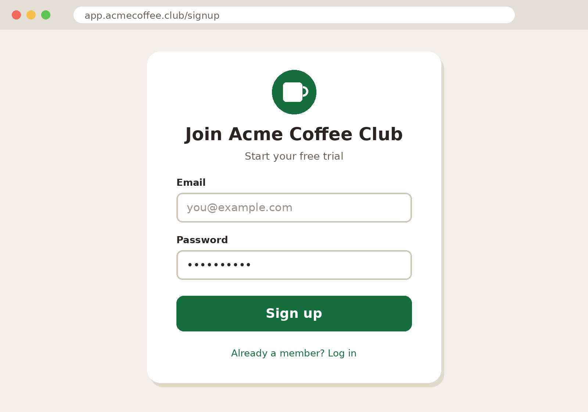

Joining Acme Coffee Club takes about two minutes. You can sign up on the website or in the Acme app.

<Steps>
  <Step title="Open the sign-up page">
    <Tabs>
      <Tab title="Website" icon="globe">
        Go to **acmecoffee.club** and click **Join** in the top corner.
      </Tab>
      <Tab title="App" icon="mobile-screen">
        Open the Acme app and tap **Get started**.
      </Tab>
    </Tabs>
  </Step>
  <Step title="Enter your email and a password">
    Type your email address and choose a password. See [Password help](/acme/password-help) for what makes a good password.

    <Frame caption="The Acme Coffee Club sign-up screen">
      
    </Frame>
  </Step>
  <Step title="Click Sign up">
    Click the green **Sign up** button. Your <Tooltip headline="Free trial" tip="Try Acme without paying. You won't be charged until your trial ends.">free trial</Tooltip> starts right away. [Learn more](/acme/free-trial).
  </Step>
  <Step title="Pick a plan">
    Choose the plan that fits you. Not sure? Compare them on [Plans & pricing](/acme/plans-and-pricing).
  </Step>
</Steps>

<Check>That's it. Your first bag of coffee is on its way.</Check>
