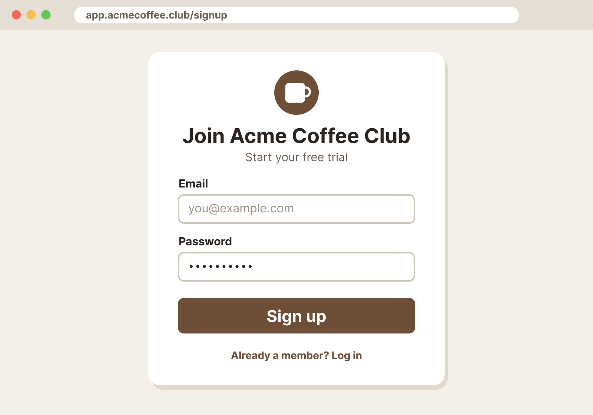

Unirte a Acme Coffee Club toma unos dos minutos. Puedes registrarte en el sitio web o en la app de Acme.

<Steps>
  <Step title="Abre la página de registro">
    <Tabs>
      <Tab title="Sitio web" icon="globe">
        Ve a **acmecoffee.club** y haz clic en **Join** en la esquina superior.
      </Tab>
      <Tab title="App" icon="mobile-screen">
        Abre la app de Acme y toca **Get started**.
      </Tab>
    </Tabs>
  </Step>
  <Step title="Ingresa tu correo electrónico y una contraseña">
    Escribe tu dirección de correo electrónico y elige una contraseña. Consulta [Ayuda con la contraseña](/es/acme/password-help) para saber qué hace que una contraseña sea buena.

    <Frame caption="La pantalla de registro de Acme Coffee Club">
      
    </Frame>
  </Step>
  <Step title="Haz clic en Sign up">
    Haz clic en el botón **Sign up** de color marrón café. Tu <Tooltip headline="Prueba gratuita" tip="Prueba Acme sin pagar. No se te cobrará hasta que termine tu prueba.">prueba gratuita</Tooltip> comienza de inmediato. [Más información](/es/acme/free-trial).
  </Step>
  <Step title="Elige un plan">
    Elige el plan que mejor se adapte a ti. ¿No estás seguro? Compáralos en [Planes y precios](/es/acme/plans-and-pricing).
  </Step>
</Steps>

<Check>Eso es todo. Tu primera bolsa de café ya va en camino.</Check>
