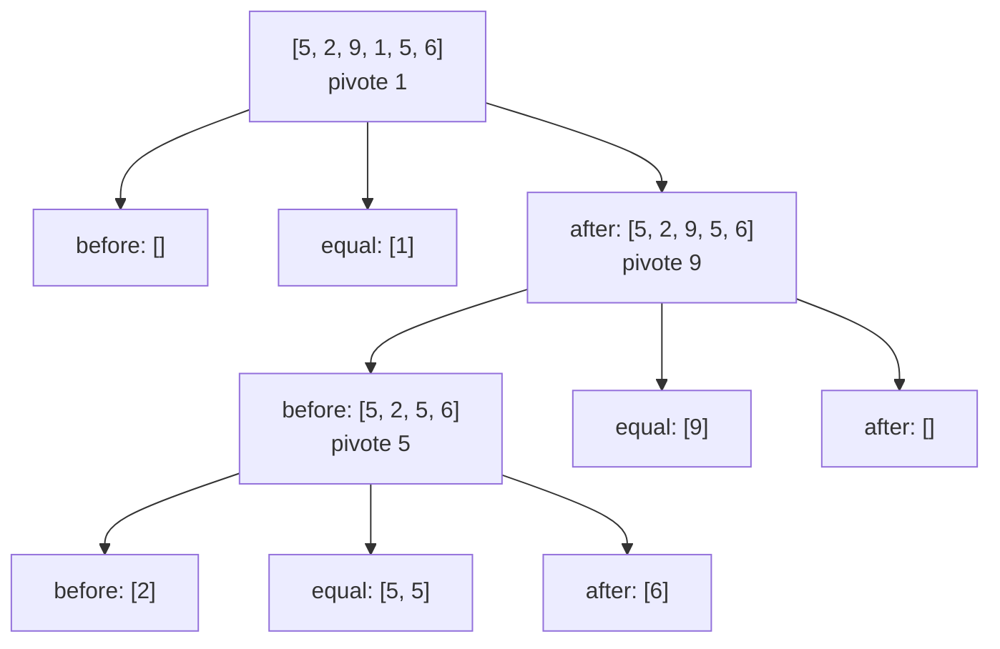

Quick sort es un algoritmo de **divide y vencerás**. Elige un elemento como **pivote**, divide el resto de la lista en elementos que van antes que él y elementos que van después, y luego ordena cada lado de la misma manera. Una lista con cero o un elemento ya está ordenada, así que la recursión se detiene ahí.

## La idea {#the-idea}

La Sort API siempre elige el elemento **central** como pivote. Luego divide la lista en tres grupos:

- `before`: elementos que se ordenan antes que el pivote
- `equal`: elementos iguales al pivote
- `after`: elementos que se ordenan después del pivote

Después, quick sort ordena `before` y `after`, y une `before + equal + after`.



## Particionar una lista {#partitioning-a-list}

La partición es el único trabajo real. Compara cada elemento con el pivote y colócalo en uno de los tres grupos.

<Steps>
  <Step title="Elige el pivote">
    Para `[5, 2, 5, 6]`, el elemento central está en el índice 2, así que el pivote es `5`.
  </Step>
  <Step title="Divide alrededor del pivote">
    `2` es menor, así que va en `before`. Ambos `5` van en `equal`. `6` es mayor, así que va en `after`.
  </Step>
  <Step title="Ordena cada lado y únelos">
    `[2]` y `[6]` tienen un elemento cada uno, así que ya están ordenados. Únelos: `[2] + [5, 5] + [6]` = `[2, 5, 5, 6]`.
  </Step>
</Steps>

Cuando `order` es `desc`, los grupos se invierten. Los elementos mayores van en `before` y los menores van en `after`.

## Míralo con la API {#see-it-with-the-api}

Pide a `/sort/steps` que ordene `[5, 2, 9, 1, 5, 6]` y devolverá cada partición:

<CodeGroup>
  ```bash Request
  curl -X POST http://localhost:8000/sort/steps \
    -H "Content-Type: application/json" \
    -d '{"numbers": [5, 2, 9, 1, 5, 6]}'
  ```

  ```json Response
  {
    "result": [1, 2, 5, 5, 6, 9],
    "count": 6,
    "order": "asc",
    "steps": [
      { "step": 1, "pivot": 1, "before": [], "equal": [1], "after": [5, 2, 9, 5, 6] },
      { "step": 2, "pivot": 9, "before": [5, 2, 5, 6], "equal": [9], "after": [] },
      { "step": 3, "pivot": 5, "before": [2], "equal": [5, 5], "after": [6] }
    ]
  }
  ```
</CodeGroup>

Los pasos se enumeran en profundidad primero. La API particiona por completo el lado `before` de un paso antes de empezar con el lado `after`. Las listas con cero o un elemento no producen ningún paso.

<Info>
  Quick sort se ejecuta en tiempo O(n log n) de media. En el peor caso, cuando el pivote cae una y otra vez en un extremo de la lista, tarda un tiempo O(n²).
</Info>

<Warning>
  La versión 2.0.0 cambió la forma de cada paso. Antes, los pasos contenían `left`, `right` y `merged`. Ahora contienen `pivot`, `before`, `equal` y `after`. Actualiza cualquier código que lea `steps` de `/sort/steps`.
</Warning>

<Expandable title="Lee el código">
  Todo el algoritmo es una función recursiva `quick_sort()` en `main.py`. Elige el elemento central, construye los grupos `before`, `equal` y `after`, y se llama a sí misma sobre `before` y `after`.
</Expandable>

¿Listo para probarlo? Ve al [inicio rápido](/es/merge-sort-api/quickstart).
