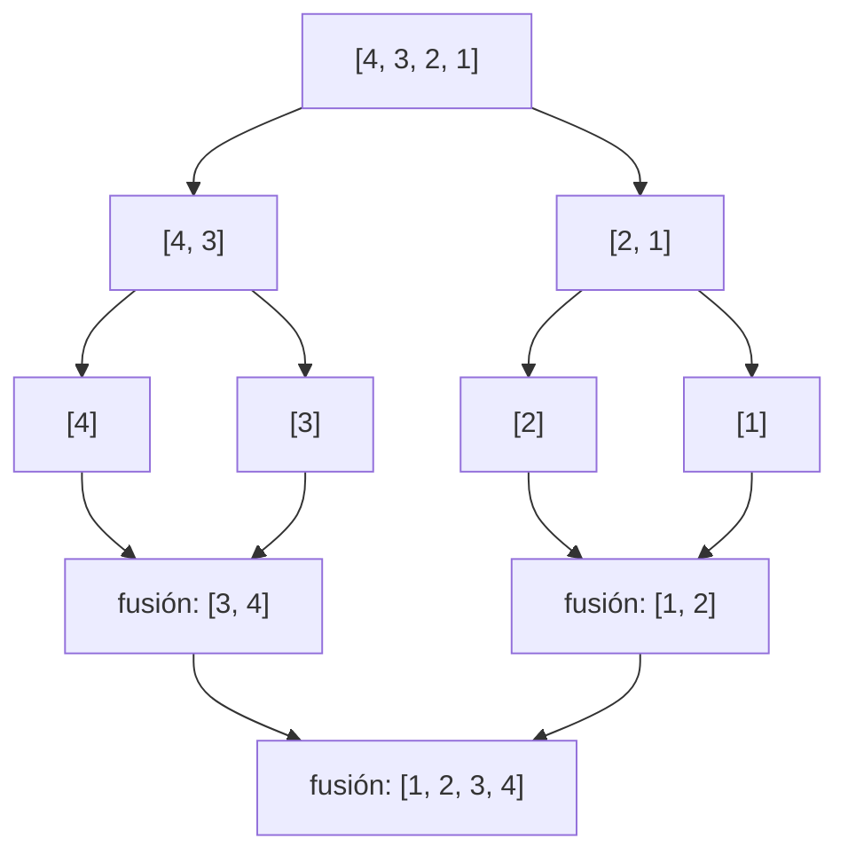

Merge sort es un algoritmo de **divide y vencerás**. Nunca compara todo con todo. Sigue dividiendo la lista hasta que cada parte tiene un solo elemento (que trivialmente está ordenado) y luego vuelve a fusionar las partes en orden.

## La idea {#the-idea}



## Fusionar dos listas ordenadas {#merging-two-sorted-lists}

La fusión es el único trabajo real. Mira el primer elemento de cada lista, toma el menor y repite.

<Steps>
  <Step title="Empieza con dos listas ordenadas">
    `left = [3, 4]` y `right = [1, 2]`
  </Step>
  <Step title="Compara los elementos del frente">
    `3` frente a `1`: toma `1`. Luego `3` frente a `2`: toma `2`.
  </Step>
  <Step title="Añade lo que queda">
    La lista derecha está vacía, así que añade el resto de la lista izquierda: `3, 4`.
  </Step>
</Steps>

## Míralo con la API {#see-it-with-the-api}

Pide a `/sort/steps` que ordene `[4, 3, 2, 1]` y devolverá cada fusión:

<CodeGroup>
  ```bash Request
  curl -X POST http://localhost:8000/sort/steps \
    -H "Content-Type: application/json" \
    -d '{"numbers": [4, 3, 2, 1]}'
  ```

  ```json Response
  {
    "result": [1, 2, 3, 4],
    "count": 4,
    "order": "asc",
    "steps": [
      { "step": 1, "left": [4], "right": [3], "merged": [3, 4] },
      { "step": 2, "left": [2], "right": [1], "merged": [1, 2] },
      { "step": 3, "left": [3, 4], "right": [1, 2], "merged": [1, 2, 3, 4] }
    ]
  }
  ```
</CodeGroup>

<Info>
  La ordenación es **estable**: los números iguales mantienen su orden original. Se ejecuta en tiempo O(n log n).
</Info>

<Expandable title="Lee el código">
  Todo el algoritmo ocupa unas 25 líneas en `main.py`: una función `merge()` que combina dos listas ordenadas y una función recursiva `merge_sort()` que divide la lista y llama a `merge()`.
</Expandable>

¿Listo para probarlo? Ve al [inicio rápido](/es/merge-sort-api/quickstart).
