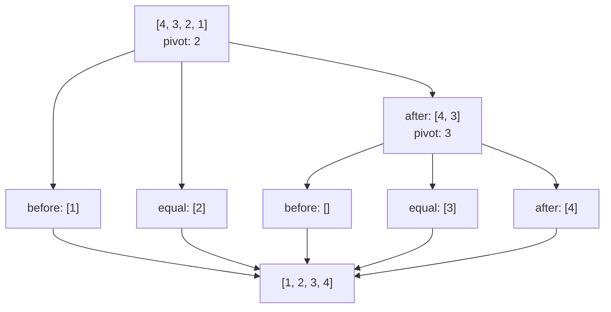

Quick sort es un algoritmo de **divide y vencerás**. Elige un elemento como **pivote**, divide el resto de la lista en los elementos que van antes del pivote y los que van después, y luego ordena cada lado de la misma manera. Una lista con cero o un elemento ya está ordenada, así que la recursión se detiene ahí.

## La idea {#the-idea}



## Particionar alrededor de un pivote {#partitioning-around-a-pivot}

La partición es el único trabajo real. La API siempre elige el **elemento central** como pivote y divide la lista en tres grupos.

<Steps>
  <Step title="Elige el pivote">
    Para `[4, 3, 2, 1]`, el elemento central (índice `4 // 2 = 2`) es `2`.
  </Step>
  <Step title="Divide en tres grupos">
    `before = [1]`, `equal = [2]` y `after = [4, 3]`. Los grupos `before` y `after` todavía no están ordenados.
  </Step>
  <Step title="Ordena cada lado y únelos">
    Aplica quick sort a los grupos `before` y `after` de la misma manera y luego une `before + equal + after`.
  </Step>
</Steps>

Cuando envías `"order": "desc"`, los grupos se invierten. Los elementos mayores que el pivote van en `before` y los menores van en `after`.

## Míralo con la API {#see-it-with-the-api}

Pide a `/sort/steps` que ordene `[4, 3, 2, 1]` y devolverá cada partición:

<CodeGroup>
  ```bash Request
  curl -X POST http://localhost:8000/sort/steps \
    -H "Content-Type: application/json" \
    -d '{"numbers": [4, 3, 2, 1]}'
  ```

  ```json Response
  {
    "result": [1, 2, 3, 4],
    "count": 4,
    "order": "asc",
    "algorithm": "quick",
    "steps": [
      { "step": 1, "pivot": 2, "before": [1], "equal": [2], "after": [4, 3] },
      { "step": 2, "pivot": 3, "before": [], "equal": [3], "after": [4] }
    ]
  }
  ```
</CodeGroup>

Cada paso tiene estos campos:

| Campo | Descripción |
| --- | --- |
| `step` | Posición (empezando en 1) de esta partición en la ejecución |
| `pivot` | El valor alrededor del cual se dividió la lista (el elemento central) |
| `before` | Elementos que se ordenan antes del pivote, todavía sin ordenar |
| `equal` | Elementos iguales al pivote |
| `after` | Elementos que se ordenan después del pivote, todavía sin ordenar |

Los pasos se listan en profundidad. La API particiona por completo el lado `before` antes de empezar con el lado `after`. Las listas con cero o un elemento no necesitan partición, así que no aparecen como pasos.

<Info>
  Quick sort se ejecuta en tiempo O(n log n) en promedio y O(n²) en el peor caso.
</Info>

<Warning>
  La versión 2.0.0 reemplazó merge sort por quick sort. `/sort/steps` ya no devuelve `left`, `right` ni `merged`. Si procesas los pasos, lee `pivot`, `before`, `equal` y `after` en su lugar. `/sort` devuelve la misma forma de respuesta que antes.
</Warning>

<Expandable title="Lee el código">
  Todo el algoritmo es una única función recursiva `quick_sort()` en `main.py`. Elige el elemento central como pivote, construye las listas `before`, `equal` y `after`, y se llama a sí misma sobre `before` y `after`.
</Expandable>

¿Listo para probarlo? Ve al [inicio rápido](/es/merge-sort-api/quickstart).
