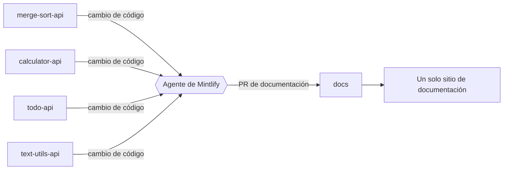

Buenas noticias: puedes leer todo este sitio sin ejecutar absolutamente nada. Relájate, échale un vistazo, asiente con aire pensativo. Pero si quieres pulsar el reluciente botón **Try it** y hacer que algo pase de verdad, necesitarás una API funcionando en tu computadora.

<Card type="tip">
  nueva función<br /><br /><br /><br />
</Card>

<Steps>
  <Step title="Reúne tu equipo de aventura">
    Necesitas Python 3.10 o posterior y `git`. Eso es todo. Sin dragones ni pactos de sangre.

    <Tabs>
      <Tab title="macOS">
        ```bash
        brew install python git
        ```
      </Tab>
      <Tab title="Linux">
        ```bash
        sudo apt install python3 python3-venv git
        ```
      </Tab>
      <Tab title="Windows">
        ```powershell
        winget install Python.Python.3.12 Git.Git
        ```
      </Tab>
    </Tabs>
  </Step>

  <Step title="Elige una API y despiértala">
    Elige a tu luchador. Todas son encantadoras. No tenemos favoritas (al menos no en voz alta).

    <CodeGroup>
      ```bash Merge Sort API
      git clone https://github.com/mintlify-demo/merge-sort-api.git
      cd merge-sort-api
      python3 -m venv .venv && source .venv/bin/activate
      pip install -r requirements.txt
      uvicorn main:app --reload
      ```

      ```bash Calculator API
      git clone https://github.com/mintlify-demo/calculator-api.git
      cd calculator-api
      python3 -m venv .venv && source .venv/bin/activate
      pip install -r requirements.txt
      uvicorn main:app --reload
      ```

      ```bash Todo API
      git clone https://github.com/mintlify-demo/todo-api.git
      cd todo-api
      python3 -m venv .venv && source .venv/bin/activate
      pip install -r requirements.txt
      uvicorn main:app --reload
      ```

      ```bash Text Utils API
      git clone https://github.com/mintlify-demo/text-utils-api.git
      cd text-utils-api
      python3 -m venv .venv && source .venv/bin/activate
      pip install -r requirements.txt
      uvicorn main:app --reload
      ```
    </CodeGroup>

    <Warning>
      Todas las APIs quieren el puerto `8000`, y no saben compartir. Ejecuta una a la vez, o manda las demás a su propio cuarto con `--port 8001`.
    </Warning>
  </Step>

  <Step title="Abre su referencia de API">
    Elige la pestaña correspondiente en la parte superior de este sitio, selecciona un endpoint y dale con fuerza a **Try it** (con cuidado, es un botón, no una piñata). El playground lanza la solicitud desde tu navegador directamente a `http://localhost:8000`. Sin intermediarios ni palomas mensajeras.
  </Step>

  <Step title="Envía una solicitud">
    Para la Todo API, usa la clave de API ultrasecreta `demo-key`. Por favor, no se lo digas a nadie. Las demás APIs son de acceso libre y no necesitan ninguna clave.
  </Step>
</Steps>

<Check>
  ¡Mírate! Estás ejecutando una API real y llamándola desde documentación generada. Anda, cuéntaselo a tu mamá.
</Check>

<Tip>
  ¿Vas a presumir de esto en vivo? Inicia la API _antes_ de la llamada (créenos) y deja tu navegador estacionado en la página del endpoint. El playground, los ejemplos de código y el visor de respuestas se actualizan mientras escribes, lo cual resulta de lo más impresionante.
</Tip>

## Solución de problemas {#troubleshooting}

¿Algo salió mal? Nos pasa hasta a los mejores.

<AccordionGroup>
  <Accordion title="El playground dice que no puede conectarse al servidor">
    ¿De verdad está en ejecución la API? Comprueba que tu terminal muestre con orgullo `Uvicorn running on http://127.0.0.1:8000`. Las APIs ya permiten solicitudes de origen cruzado, así que no hay ningún saludo secreto que configurar.
  </Accordion>
  <Accordion title="`pip install` falla">
    Nueve de cada diez veces, el entorno virtual no está activado. Tu prompt debería comenzar con `(.venv)`. Si no es así, el venv está durmiendo la siesta. Despiértalo y vuelve a intentarlo.
  </Accordion>
  <Accordion title="El puerto 8000 ya está en uso">
    Alguien está sentado en tu asiento. Detén la otra API o múdate amablemente con `uvicorn main:app --port 8001`.
  </Accordion>
</AccordionGroup>

## Cómo está construido este sitio {#how-this-site-is-built}

El código y las pruebas de cada API viven en el propio repositorio de esa API, como adultos responsables. Toda la documentación, incluidas las guías y la especificación OpenAPI de cada API, vive junta en el [repositorio de documentación](https://github.com/mintlify-demo/docs). Cuando cambia el código de una API, el agente de Mintlify se da cuenta (es muy observador) y abre una pull request en el repositorio de documentación con la actualización correspondiente. Nadie tiene que acordarse. Nadie tiene que insistir.



<Columns cols={2}>
  <Card title="Componentes" icon="shapes" href="/es/showcase/components">
    Cada pieza de Lego utilizada para construir este sitio.
  </Card>
  <Card title="Funciones de IA" icon="sparkles" href="/es/showcase/ai">
    El asistente, llms.txt, el servidor MCP y otra magia robótica.
  </Card>
</Columns>
