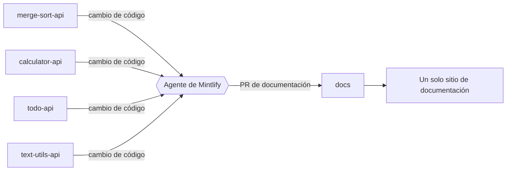

Puedes leer todo este sitio sin ejecutar nada. Para usar el playground **Try it**, ejecuta una API en tu computadora.

<Steps>
  <Step title="Comprueba lo que necesitas">
    Necesitas Python 3.10 o posterior y `git`.

    <Tabs>
      <Tab title="macOS">
        ```bash
        brew install python git
        ```
      </Tab>
      <Tab title="Linux">
        ```bash
        sudo apt install python3 python3-venv git
        ```
      </Tab>
      <Tab title="Windows">
        ```powershell
        winget install Python.Python.3.12 Git.Git
        ```
      </Tab>
    </Tabs>
  </Step>

  <Step title="Elige una API e iníciala">
    <CodeGroup>
      ```bash Merge Sort API
      git clone https://github.com/mintlify-demo/merge-sort-api.git
      cd merge-sort-api
      python3 -m venv .venv && source .venv/bin/activate
      pip install -r requirements.txt
      uvicorn main:app --reload
      ```

      ```bash Calculator API
      git clone https://github.com/mintlify-demo/calculator-api.git
      cd calculator-api
      python3 -m venv .venv && source .venv/bin/activate
      pip install -r requirements.txt
      uvicorn main:app --reload
      ```

      ```bash Todo API
      git clone https://github.com/mintlify-demo/todo-api.git
      cd todo-api
      python3 -m venv .venv && source .venv/bin/activate
      pip install -r requirements.txt
      uvicorn main:app --reload
      ```

      ```bash Text Utils API
      git clone https://github.com/mintlify-demo/text-utils-api.git
      cd text-utils-api
      python3 -m venv .venv && source .venv/bin/activate
      pip install -r requirements.txt
      uvicorn main:app --reload
      ```
    </CodeGroup>

    <Warning>
      Todas las APIs usan el puerto `8000`. Ejecuta una a la vez, o inicia las demás con `--port 8001`.
    </Warning>
  </Step>

  <Step title="Abre su referencia de API">
    Elige la pestaña correspondiente en la parte superior de este sitio, selecciona un endpoint y haz clic en **Try it**. El playground envía la solicitud desde tu navegador directamente a `http://localhost:8000`.
  </Step>

  <Step title="Envía una solicitud">
    Para la Todo API, introduce `demo-key` como clave de API. Las demás APIs no necesitan clave.
  </Step>
</Steps>

<Check>
  Estás ejecutando una API real y llamándola desde documentación generada.
</Check>

<Tip>
  ¿Vas a mostrar esto en vivo? Inicia la API antes de la llamada y mantén tu navegador en la página del endpoint. El playground, los ejemplos de código y el visor de respuestas se actualizan mientras escribes.
</Tip>

## Solución de problemas {#troubleshooting}

<AccordionGroup>
  <Accordion title="El playground dice que no puede conectarse al servidor">
    Asegúrate de que la API esté en ejecución y muestre `Uvicorn running on http://127.0.0.1:8000`. Las APIs permiten solicitudes de origen cruzado, así que no se necesita configuración adicional.
  </Accordion>
  <Accordion title="`pip install` falla">
    Comprueba que activaste el entorno virtual: tu prompt debería comenzar con `(.venv)`.
  </Accordion>
  <Accordion title="El puerto 8000 ya está en uso">
    Detén la otra API o ejecuta `uvicorn main:app --port 8001`.
  </Accordion>
</AccordionGroup>

## Cómo está construido este sitio {#how-this-site-is-built}

El código y las pruebas de cada API viven en el repositorio de esa API. Toda la documentación, incluidas las guías y la especificación OpenAPI de cada API, vive en el [repositorio de documentación](https://github.com/mintlify-demo/docs). Cuando cambia el código de una API, el agente de Mintlify abre una pull request en el repositorio de documentación con la actualización correspondiente.



<Columns cols={2}>
  <Card title="Componentes" icon="shapes" href="/es/showcase/components">
    Cada pieza utilizada en este sitio.
  </Card>
  <Card title="Funciones de IA" icon="sparkles" href="/es/showcase/ai">
    El asistente, llms.txt, el servidor MCP y más.
  </Card>
</Columns>
