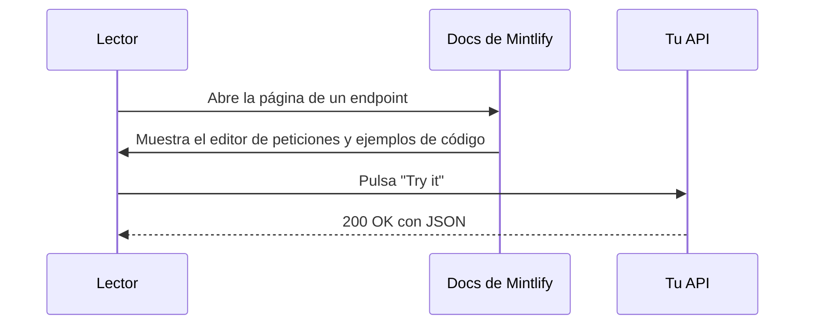
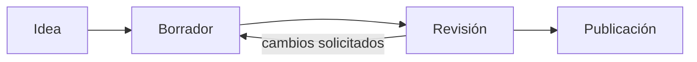

Cada ejemplo de esta página es MDX real. Usa la opción **Ver como Markdown** de la página para copiar cualquiera de ellos.

## Avisos

<Note>Una **nota** añade contexto.</Note>
<Tip>Un **consejo** comparte un atajo o una buena práctica.</Tip>
<Info>Un aviso de **información** destaca un dato útil.</Info>
<Check>Una **confirmación** indica que algo salió bien.</Check>
<Warning>Una **advertencia** señala algo con lo que hay que tener cuidado.</Warning>
<Danger>Un aviso de **peligro** marca algo que puede romper cosas.</Danger>

## Tarjetas

<CardGroup cols={3}>
  <Card title="Tarjeta simple" icon="star">
    Una tarjeta con un icono y texto.
  </Card>
  <Card title="Tarjeta con enlace" icon="link" href="/es/quickstart">
    Añade `href` y toda la tarjeta se puede pulsar.
  </Card>
  <Card title="Tarjeta con CTA" icon="arrow-right" href="/es/changelog" cta="Ver el registro de cambios">
    Añade `cta` para personalizar el texto del enlace.
  </Card>
</CardGroup>

<Card title="Tarjeta horizontal" icon="grip-lines" horizontal>
  Usa `horizontal` para un diseño compacto de ancho completo.
</Card>

## Columnas

<Columns cols={2}>
  <Card title="Columna izquierda" icon="arrow-left">Las columnas organizan cualquier contenido en una cuadrícula adaptable.</Card>
  <Card title="Columna derecha" icon="arrow-right">En pantallas pequeñas se apilan.</Card>
</Columns>

## Pasos

<Steps>
  <Step title="Primer paso" icon="1">
    Los pasos numeran un procedimiento automáticamente.
  </Step>
  <Step title="Segundo paso">
    Un paso puede contener cualquier cosa, incluido código:

    ```bash
    echo "hola desde un paso"
    ```
  </Step>
  <Step title="Tercer paso">
    Listo.
  </Step>
</Steps>

## Pestañas

<Tabs>
  <Tab title="Primera pestaña" icon="1">
    Las pestañas alternan entre opciones, como sistemas operativos o lenguajes.
  </Tab>
  <Tab title="Segunda pestaña" icon="2">
    La elección del lector se recuerda en todas las páginas que usan los mismos títulos de pestaña.
  </Tab>
</Tabs>

## Grupos de código y bloques de código

<CodeGroup>
  ```python Python
  def greet(name: str) -> str:
      return f"Hello, {name}!"
  ```

  ```javascript JavaScript
  const greet = (name) => `Hello, ${name}!`;
  ```

  ```go Go
  func greet(name string) string { return "Hello, " + name + "!" }
  ```
</CodeGroup>

```python title="highlight.py" lines highlight={2,3}
def total(items):
    subtotal = sum(items)       # resaltado
    return subtotal * 1.08      # resaltado
```

## Acordeones

<AccordionGroup>
  <Accordion title="Cerrado por defecto" icon="chevron-down">
    Los acordeones ocultan los detalles hasta que el lector los necesita.
  </Accordion>
  <Accordion title="Abierto por defecto" defaultOpen>
    Usa `defaultOpen` para que empiece desplegado.
  </Accordion>
</AccordionGroup>

## Diagramas con Mermaid

Escribe un bloque `mermaid` y Mintlify lo dibuja, en modo claro y oscuro.



Los diagramas de flujo funcionan igual.



## Campos de API

<ParamField path="user_id" type="string" required>
  El ID del usuario. Los parámetros de ruta, los parámetros de consulta, las cabeceras y los campos del cuerpo tienen cada uno su variante.
</ParamField>

<ParamField query="limit" type="integer" default="10">
  Número máximo de resultados.
</ParamField>

<ResponseField name="user" type="object" required>
  El objeto de usuario.

  <Expandable title="propiedades">
    <ResponseField name="name" type="string">El nombre del usuario.</ResponseField>
    <ResponseField name="plan" type="string" default="free">El plan del usuario.</ResponseField>
  </Expandable>
</ResponseField>

## Ejemplos de petición y respuesta

<RequestExample>
  ```bash Petición
  curl https://api.example.com/users/42
  ```
</RequestExample>

<ResponseExample>
  ```json Respuesta
  { "user": { "name": "Ada", "plan": "free" } }
  ```
</ResponseExample>

## Marcos e imágenes

<Frame caption="Una imagen SVG dentro de un Frame, con pie de foto.">
  
</Frame>

## Insignias, tooltips e iconos

<Badge color="green" icon="circle-check">Estable</Badge> <Badge color="orange" icon="clock">Beta</Badge> <Badge color="red" icon="ban">Obsoleto</Badge> <Badge color="blue" stroke>Contorno</Badge> <Badge color="purple" shape="pill">Píldora</Badge>

Pasa el cursor sobre <Tooltip headline="OpenAPI" tip="Un formato estándar para describir APIs HTTP. Mintlify lo convierte en una referencia de API interactiva.">OpenAPI</Tooltip> para ver un tooltip.

Iconos en línea: <Icon icon="rocket" size={16} /> <Icon icon="bolt" size={16} color="#0D9373" /> <Icon icon="heart" size={16} color="#EF4444" />

## Árbol

<Tree>
  <Tree.Folder name="merge-sort-api" defaultOpen>
    <Tree.File name="main.py" />
    <Tree.File name="requirements.txt" />
    <Tree.Folder name="tests">
      <Tree.File name="test_main.py" />
    </Tree.Folder>
    <Tree.Folder name="docs" defaultOpen>
      <Tree.File name="docs.json" />
      <Tree.File name="index.mdx" />
      <Tree.File name="openapi.json" />
    </Tree.Folder>
  </Tree.Folder>
</Tree>

## Colores

<Color variant="compact">
  <Color.Item name="primary" value="#0D9373" />
  <Color.Item name="light" value="#55D799" />
  <Color.Item name="surface" value={{ light: "#F8FAFC", dark: "#0F172A" }} />
</Color>

## Tarjeta de repositorio de GitHub

<GitHub.Repo repo="mintlify/docs" />

## Prompt

<Prompt description="Dáselo a tu agente de programación para que escriba docs con tu estilo.">
Eres un redactor técnico. Escribe documentación clara y concisa para desarrolladores.
- Usa la segunda persona ("tú") y verbos en voz activa.
- Empieza cada procedimiento con un título orientado al objetivo.
- Incluye un ejemplo de código ejecutable para cada endpoint.
</Prompt>

## Vistas

<View title="Python" icon="python">
  ```python
  print("Las vistas cambian el contenido de toda la página.")
  ```
</View>

<View title="JavaScript" icon="js">
  ```javascript
  console.log("Elige un lenguaje y la página cambia.");
  ```
</View>

## Matemáticas

Matemáticas en línea como $E = mc^2$ y en bloque:

$$
\sum_{i=1}^{n} i = \frac{n(n+1)}{2}
$$

## Tablas y Markdown

| Función | Free | Pro | Enterprise |
| --- | :---: | :---: | :---: |
| Alojamiento de docs | Sí | Sí | Sí |
| Asistente de IA | | Sí | Sí |
| Proyectos multirrepositorio | | | Sí |

> Las citas, la **negrita**, la *cursiva*, el ~~tachado~~, el `código en línea` y los [enlaces](/es/quickstart) funcionan como esperas.

- [x] Las listas de tareas
- [ ] también funcionan

<Panel>
  <Info>
    Un **Panel** fija contenido en el lado derecho de la página. Úsalo para ejemplos, resúmenes o enlaces.
  </Info>
</Panel>
