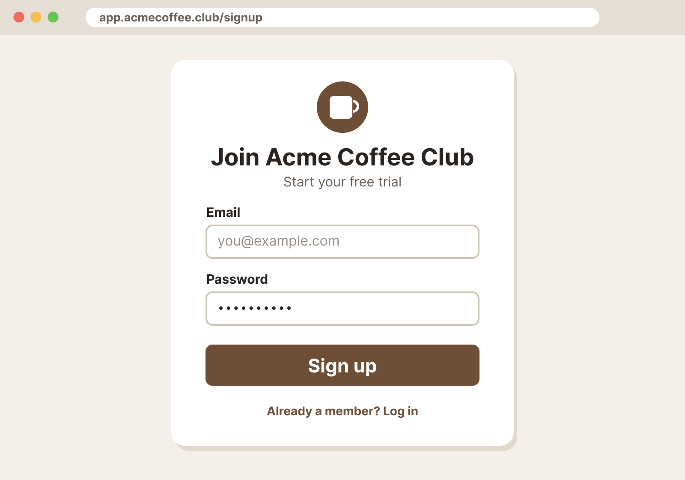

Rejoindre Acme Coffee Club prend environ deux minutes. Vous pouvez vous inscrire sur le site web ou dans l'application Acme.

<Steps>
  <Step title="Ouvrez la page d'inscription">
    <Tabs>
      <Tab title="Site web" icon="globe">
        Rendez-vous sur **acmecoffee.club** et cliquez sur **Rejoindre** dans le coin supérieur.
      </Tab>
      <Tab title="Application" icon="mobile-screen">
        Ouvrez l'application Acme et appuyez sur **Commencer**.
      </Tab>
    </Tabs>
  </Step>
  <Step title="Saisissez votre e-mail et un mot de passe">
    Saisissez votre adresse e-mail et choisissez un mot de passe. Consultez [Aide sur le mot de passe](/fr/acme/password-help) pour savoir ce qui fait un bon mot de passe.

    <Frame caption="L'écran d'inscription d'Acme Coffee Club">
      
    </Frame>
  </Step>
  <Step title="Cliquez sur S'inscrire">
    Cliquez sur le bouton **S'inscrire** marron café. Votre <Tooltip headline="Essai gratuit" tip="Essayez Acme sans payer. Vous ne serez pas débité avant la fin de votre essai.">essai gratuit</Tooltip> commence immédiatement. [En savoir plus](/fr/acme/free-trial).
  </Step>
  <Step title="Choisissez une formule">
    Choisissez la formule qui vous convient. Vous hésitez ? Comparez-les sur [Formules et tarifs](/fr/acme/plans-and-pricing).
  </Step>
</Steps>

<Check>C'est tout. Votre premier sachet de café est en route.</Check>
