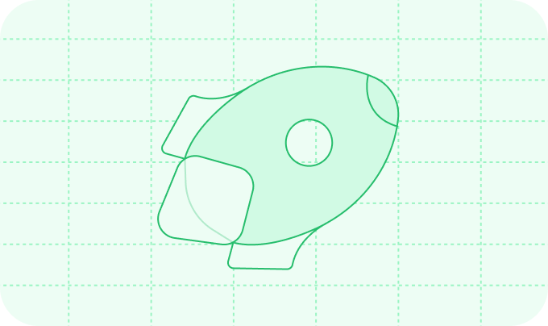
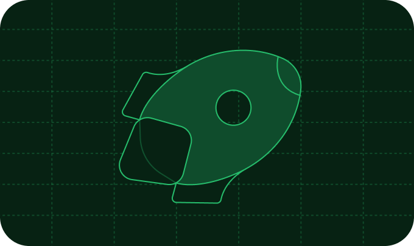
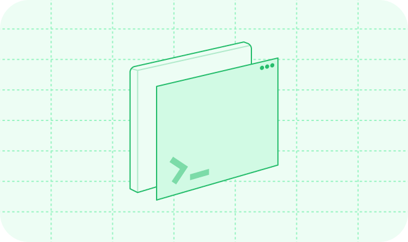
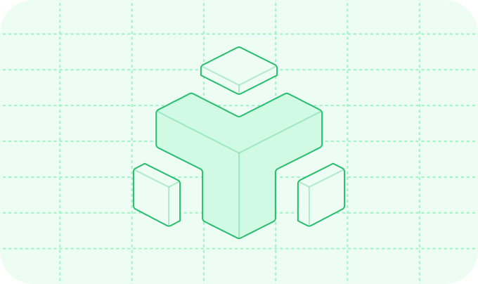
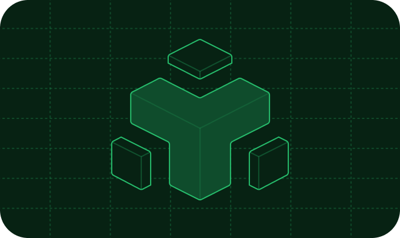
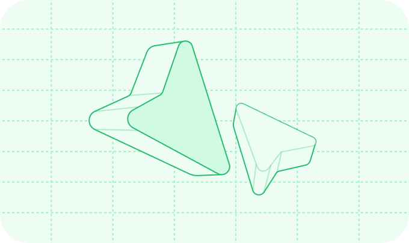
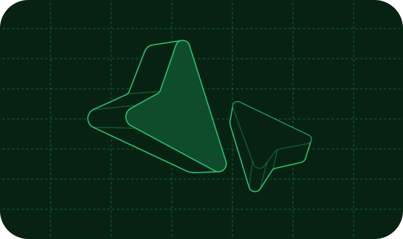

  

    
    
  

  

    <h1 className="block text-4xl font-medium text-center text-gray-900 dark:text-zinc-50 tracking-tight">
      Démo Mintlify
    </h1>

    

      Quatre API, chacune avec son propre dépôt de code, documentées ensemble sur un seul site avec des références interactives et l'IA intégrée.
    

    

      <a className="group cursor-pointer pb-8" href="/fr/quickstart">
        
        
        <h3 className="mt-5 text-gray-900 dark:text-zinc-50 font-medium">Démarrage rapide</h3>
        Exécutez une API en local et appelez-la depuis la documentation
      </a>
      <a className="group cursor-pointer pb-8" href="/fr/calculator-api">
        
        
        <h3 className="mt-5 text-gray-900 dark:text-zinc-50 font-medium">Bac à sable d'API</h3>
        Envoyez de vraies requêtes depuis une référence d'API générée
      </a>
      <a className="group cursor-pointer pb-8" href="/fr/showcase/components">
        
        
        <h3 className="mt-5 text-gray-900 dark:text-zinc-50 font-medium">Composants</h3>
        Cartes, étapes, onglets, diagrammes, champs d'API et plus encore
      </a>
      <a className="group cursor-pointer pb-8" href="/fr/showcase/ai">
        
        
        <h3 className="mt-5 text-gray-900 dark:text-zinc-50 font-medium">Fonctionnalités d'IA</h3>
        L'assistant, llms.txt, le serveur MCP et le menu contextuel
      </a>
    

  

  

    <h2 className="text-2xl font-medium text-gray-900 dark:text-zinc-50 tracking-tight">
      API d'exemple
    </h2>
    

      Le code et les tests de chaque API se trouvent dans leur propre dépôt. Leur documentation se trouve ici, et l'agent de Mintlify la met à jour lorsque le code change.
    

    <Columns cols={2}>
      <Card title="Merge Sort API" icon="arrow-down-wide-short" href="/fr/merge-sort-api">
        Triez une liste et visualisez chaque étape de fusion.
      </Card>
      <Card title="Calculator API" icon="calculator" href="/fr/calculator-api">
        Les versions 1 et 2 côte à côte, avec des erreurs typées.
      </Card>
      <Card title="Todo API" icon="list-check" href="/fr/todo-api">
        Authentification par clé d'API, pagination et un endpoint obsolète.
      </Card>
      <Card title="Text Utils API" icon="font" href="/fr/text-utils-api">
        Des exemples de code en quatre langages issus de la spécification OpenAPI.
      </Card>
    </Columns>

    <h2 className="mt-12 text-2xl font-medium text-gray-900 dark:text-zinc-50 tracking-tight">
      Dépôts sources
    </h2>
    

      Le dépôt de la documentation et le code derrière chaque API.
    

    <Columns cols={2}>
      <GitHub.Repo repo="mintlify-demo/docs" variant="flat" />
      <GitHub.Repo repo="mintlify-demo/merge-sort-api" variant="flat" />
      <GitHub.Repo repo="mintlify-demo/calculator-api" variant="flat" />
      <GitHub.Repo repo="mintlify-demo/todo-api" variant="flat" />
      <GitHub.Repo repo="mintlify-demo/text-utils-api" variant="flat" />
      <GitHub.Repo repo="mintlify-demo/demo-info-api" variant="flat" />
    </Columns>
  

