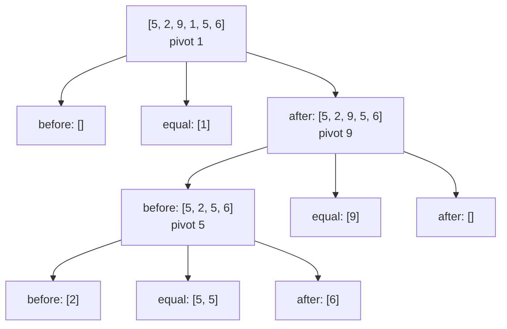

Le tri rapide est un algorithme de type **diviser pour régner**. Il choisit un élément comme **pivot**, répartit le reste de la liste entre les éléments qui viennent avant lui et ceux qui viennent après, puis trie chaque côté de la même manière. Une liste de zéro ou un élément est déjà triée : la récursion s'arrête donc là.

## Le principe {#the-idea}

La Sort API choisit toujours l'élément du **milieu** comme pivot. Elle répartit ensuite la liste en trois groupes :

- `before` : les éléments qui se placent avant le pivot
- `equal` : les éléments égaux au pivot
- `after` : les éléments qui se placent après le pivot

Le tri rapide trie ensuite `before` et `after`, puis assemble `before + equal + after`.



## Partitionner une liste {#partitioning-a-list}

Le partitionnement est le seul vrai travail. Comparez chaque élément au pivot et placez-le dans l'un des trois groupes.

<Steps>
  <Step title="Choisir le pivot">
    Pour `[5, 2, 5, 6]`, l'élément du milieu se trouve à l'index 2 : le pivot est donc `5`.
  </Step>
  <Step title="Répartir autour du pivot">
    `2` est plus petit, il va donc dans `before`. Les deux `5` vont dans `equal`. `6` est plus grand, il va donc dans `after`.
  </Step>
  <Step title="Trier chaque côté et assembler">
    `[2]` et `[6]` ne contiennent qu'un élément chacun : ils sont donc déjà triés. On les assemble : `[2] + [5, 5] + [6]` = `[2, 5, 5, 6]`.
  </Step>
</Steps>

Lorsque `order` vaut `desc`, les groupes s'inversent. Les éléments plus grands vont dans `before` et les plus petits dans `after`.

## Le voir avec l'API {#see-it-with-the-api}

Demandez à `/sort/steps` de trier `[5, 2, 9, 1, 5, 6]` et il renvoie chaque partition :

<CodeGroup>
  ```bash Request
  curl -X POST http://localhost:8000/sort/steps \
    -H "Content-Type: application/json" \
    -d '{"numbers": [5, 2, 9, 1, 5, 6]}'
  ```

  ```json Response
  {
    "result": [1, 2, 5, 5, 6, 9],
    "count": 6,
    "order": "asc",
    "steps": [
      { "step": 1, "pivot": 1, "before": [], "equal": [1], "after": [5, 2, 9, 5, 6] },
      { "step": 2, "pivot": 9, "before": [5, 2, 5, 6], "equal": [9], "after": [] },
      { "step": 3, "pivot": 5, "before": [2], "equal": [5, 5], "after": [6] }
    ]
  }
  ```
</CodeGroup>

Les étapes sont listées en profondeur d'abord. L'API partitionne entièrement le côté `before` d'une étape avant de commencer le côté `after`. Les listes de zéro ou un élément ne produisent pas d'étape.

<Info>
  Le tri rapide s'exécute en temps O(n log n) en moyenne. Dans le pire des cas, lorsque le pivot tombe sans cesse à une extrémité de la liste, il prend un temps O(n²).
</Info>

<Warning>
  La version 2.0.0 a modifié la structure de chaque étape. Les étapes contenaient auparavant `left`, `right` et `merged`. Elles contiennent désormais `pivot`, `before`, `equal` et `after`. Mettez à jour tout code qui lit `steps` depuis `/sort/steps`.
</Warning>

<Expandable title="Lire le code">
  L'algorithme complet est une fonction récursive `quick_sort()` dans `main.py`. Elle choisit l'élément du milieu, construit les groupes `before`, `equal` et `after`, puis s'appelle elle-même sur `before` et `after`.
</Expandable>

Prêt à essayer ? Rendez-vous au [démarrage rapide](/fr/merge-sort-api/quickstart).
