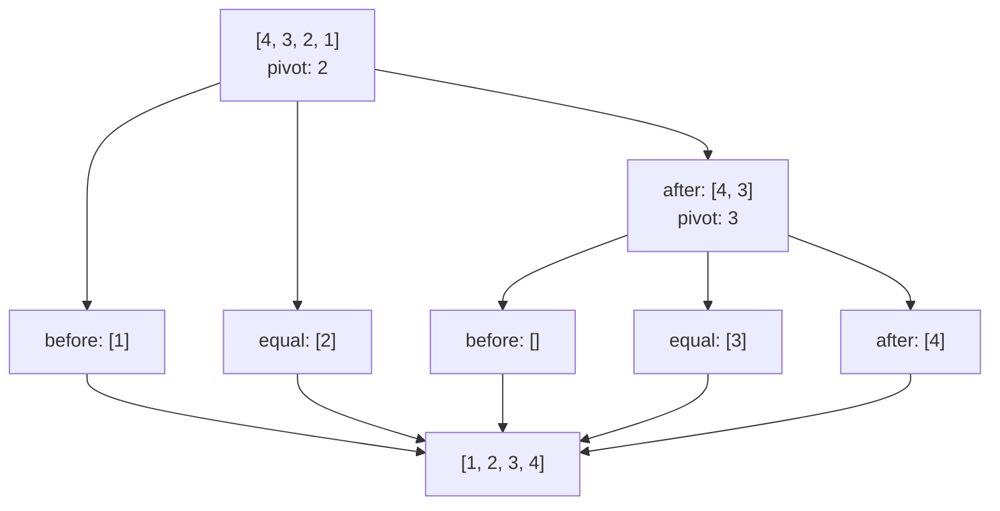

Le tri rapide est un algorithme de type **diviser pour régner**. Il choisit un élément comme **pivot**, divise le reste de la liste en éléments qui viennent avant le pivot et éléments qui viennent après, puis trie chaque côté de la même façon. Une liste de zéro ou un élément est déjà triée : la récursion s'arrête donc là.

## Le principe {#the-idea}



## Partitionner autour d'un pivot {#partitioning-around-a-pivot}

La partition est le seul vrai travail. L'API choisit toujours l'**élément du milieu** comme pivot et divise la liste en trois groupes.

<Steps>
  <Step title="Choisir le pivot">
    Pour `[4, 3, 2, 1]`, l'élément du milieu (indice `4 // 2 = 2`) est `2`.
  </Step>
  <Step title="Diviser en trois groupes">
    `before = [1]`, `equal = [2]` et `after = [4, 3]`. Les groupes `before` et `after` ne sont pas encore triés.
  </Step>
  <Step title="Trier chaque côté et assembler">
    Appliquez le tri rapide aux groupes `before` et `after` de la même façon, puis assemblez `before + equal + after`.
  </Step>
</Steps>

Lorsque vous envoyez `"order": "desc"`, les groupes s'inversent. Les éléments plus grands que le pivot vont dans `before`, et les plus petits dans `after`.

## Le voir avec l'API {#see-it-with-the-api}

Demandez à `/sort/steps` de trier `[4, 3, 2, 1]` et il renvoie chaque partition :

<CodeGroup>
  ```bash Request
  curl -X POST http://localhost:8000/sort/steps \
    -H "Content-Type: application/json" \
    -d '{"numbers": [4, 3, 2, 1]}'
  ```

  ```json Response
  {
    "result": [1, 2, 3, 4],
    "count": 4,
    "order": "asc",
    "algorithm": "quick",
    "steps": [
      { "step": 1, "pivot": 2, "before": [1], "equal": [2], "after": [4, 3] },
      { "step": 2, "pivot": 3, "before": [], "equal": [3], "after": [4] }
    ]
  }
  ```
</CodeGroup>

Chaque étape comporte les champs suivants :

| Champ | Description |
| --- | --- |
| `step` | Position (à partir de 1) de cette partition dans l'exécution |
| `pivot` | La valeur autour de laquelle la liste a été divisée (l'élément du milieu) |
| `before` | Les éléments placés avant le pivot, encore non triés |
| `equal` | Les éléments égaux au pivot |
| `after` | Les éléments placés après le pivot, encore non triés |

Les étapes sont listées en profondeur d'abord. L'API partitionne entièrement le côté `before` avant de commencer le côté `after`. Les listes de zéro ou un élément ne nécessitent aucune partition : elles n'apparaissent donc pas comme étapes.

<Info>
  Le tri rapide s'exécute en temps O(n log n) en moyenne et O(n²) dans le pire des cas.
</Info>

<Warning>
  La version 2.0.0 a remplacé le tri fusion par le tri rapide. `/sort/steps` ne renvoie plus `left`, `right` et `merged`. Si vous analysez les étapes, lisez plutôt `pivot`, `before`, `equal` et `after`. `/sort` renvoie la même forme de réponse qu'auparavant.
</Warning>

<Expandable title="Lire le code">
  L'algorithme complet tient en une seule fonction récursive `quick_sort()` dans `main.py`. Elle choisit l'élément du milieu comme pivot, construit les listes `before`, `equal` et `after`, puis s'appelle elle-même sur `before` et `after`.
</Expandable>

Prêt à essayer ? Rendez-vous au [démarrage rapide](/fr/merge-sort-api/quickstart).
