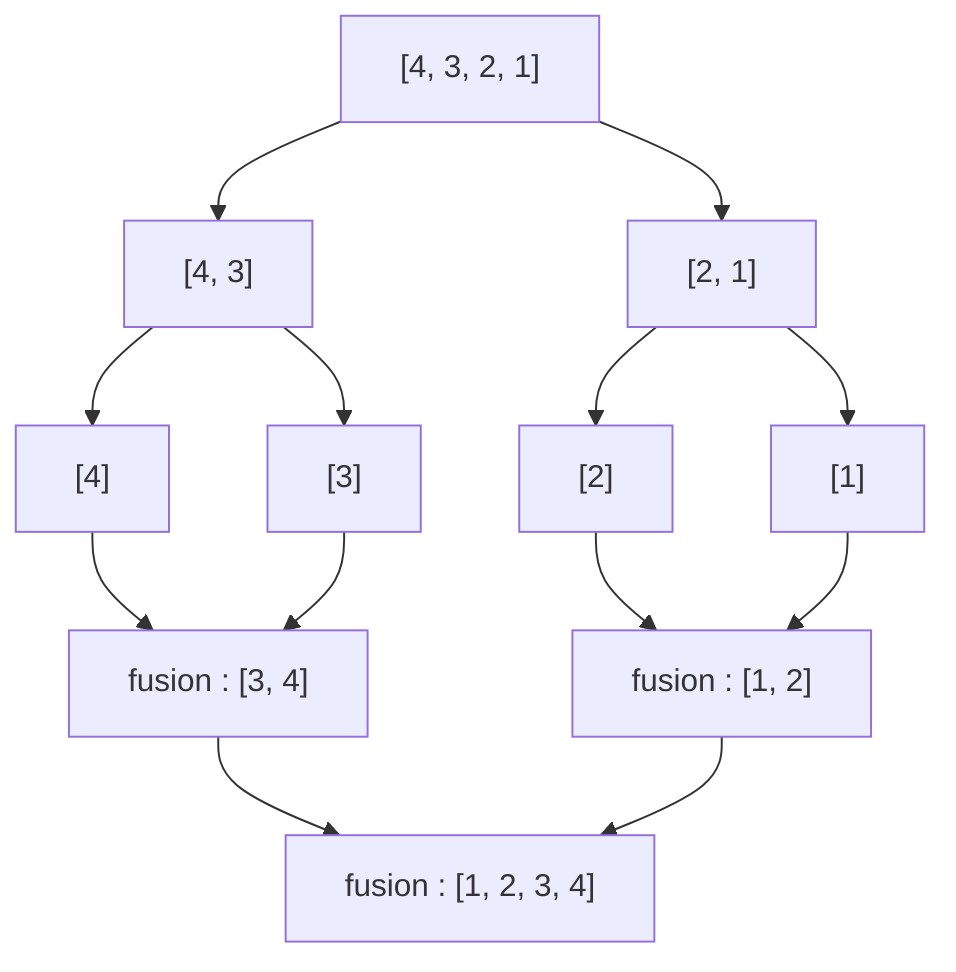

Le tri fusion est un algorithme de type **diviser pour régner**. Il ne compare jamais tout avec tout. Il divise la liste jusqu'à ce que chaque morceau ne contienne qu'un seul élément (trivialement trié), puis fusionne les morceaux dans l'ordre.

## Le principe {#the-idea}



## Fusionner deux listes triées {#merging-two-sorted-lists}

La fusion est le seul vrai travail. Regardez le premier élément de chaque liste, prenez le plus petit, et recommencez.

<Steps>
  <Step title="Partir de deux listes triées">
    `left = [3, 4]` et `right = [1, 2]`
  </Step>
  <Step title="Comparer les premiers éléments">
    `3` contre `1` : on prend `1`. Puis `3` contre `2` : on prend `2`.
  </Step>
  <Step title="Ajouter ce qui reste">
    La liste de droite est vide, on ajoute donc le reste de la liste de gauche : `3, 4`.
  </Step>
</Steps>

## Le voir avec l'API {#see-it-with-the-api}

Demandez à `/sort/steps` de trier `[4, 3, 2, 1]` et il renvoie chaque fusion :

<CodeGroup>
  ```bash Request
  curl -X POST http://localhost:8000/sort/steps \
    -H "Content-Type: application/json" \
    -d '{"numbers": [4, 3, 2, 1]}'
  ```

  ```json Response
  {
    "result": [1, 2, 3, 4],
    "count": 4,
    "order": "asc",
    "steps": [
      { "step": 1, "left": [4], "right": [3], "merged": [3, 4] },
      { "step": 2, "left": [2], "right": [1], "merged": [1, 2] },
      { "step": 3, "left": [3, 4], "right": [1, 2], "merged": [1, 2, 3, 4] }
    ]
  }
  ```
</CodeGroup>

<Info>
  Le tri est **stable** : les nombres égaux conservent leur ordre d'origine. Il s'exécute en temps O(n log n).
</Info>

<Expandable title="Lire le code">
  L'algorithme complet tient en environ 25 lignes dans `main.py` : une fonction `merge()` qui combine deux listes triées, et une fonction récursive `merge_sort()` qui divise la liste et appelle `merge()`.
</Expandable>

Prêt à essayer ? Rendez-vous au [démarrage rapide](/fr/merge-sort-api/quickstart).
