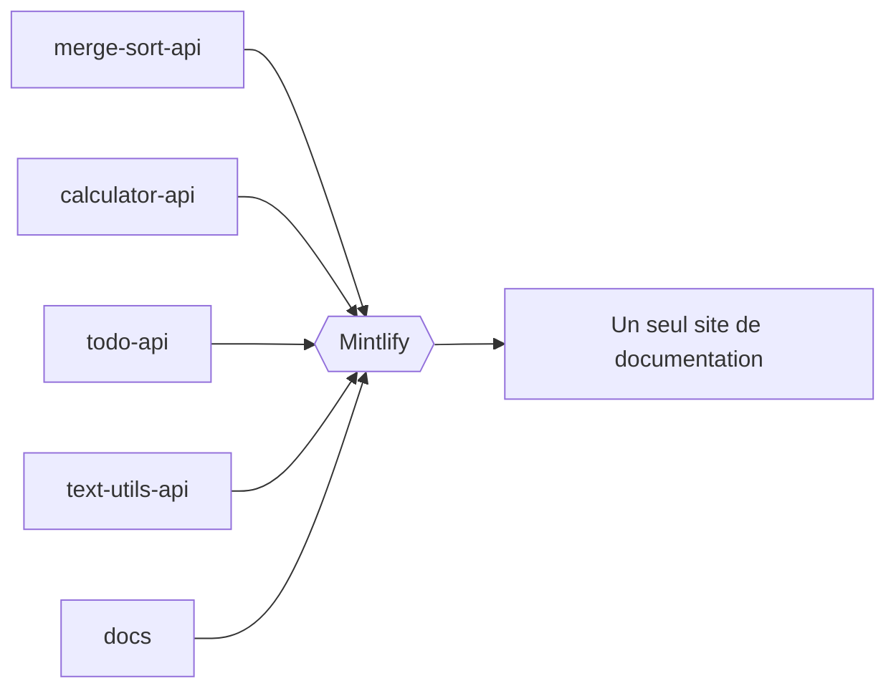

Vous pouvez lire tout ce site sans rien lancer. Pour utiliser le playground **Try it**, lancez une API sur votre ordinateur.

<Steps>
  <Step title="Vérifiez les prérequis">
    Il vous faut Python 3.10 ou plus récent et `git`.

    <Tabs>
      <Tab title="macOS">
        ```bash
        brew install python git
        ```
      </Tab>
      <Tab title="Linux">
        ```bash
        sudo apt install python3 python3-venv git
        ```
      </Tab>
      <Tab title="Windows">
        ```powershell
        winget install Python.Python.3.12 Git.Git
        ```
      </Tab>
    </Tabs>
  </Step>

  <Step title="Choisissez une API et démarrez-la">
    <CodeGroup>
      ```bash Sort API
      git clone https://github.com/mintlify-demo/merge-sort-api.git
      cd merge-sort-api
      python3 -m venv .venv && source .venv/bin/activate
      pip install -r requirements.txt
      uvicorn main:app --reload
      ```

      ```bash Calculator API
      git clone https://github.com/mintlify-demo/calculator-api.git
      cd calculator-api
      python3 -m venv .venv && source .venv/bin/activate
      pip install -r requirements.txt
      uvicorn main:app --reload
      ```

      ```bash Todo API
      git clone https://github.com/mintlify-demo/todo-api.git
      cd todo-api
      python3 -m venv .venv && source .venv/bin/activate
      pip install -r requirements.txt
      uvicorn main:app --reload
      ```

      ```bash Text Utils API
      git clone https://github.com/mintlify-demo/text-utils-api.git
      cd text-utils-api
      python3 -m venv .venv && source .venv/bin/activate
      pip install -r requirements.txt
      uvicorn main:app --reload
      ```
    </CodeGroup>

    <Warning>
      Toutes les API utilisent le port `8000`. Lancez-en une à la fois, ou démarrez les autres avec `--port 8001`.
    </Warning>
  </Step>

  <Step title="Ouvrez sa référence d'API">
    Ouvrez l'onglet **APIs** en haut de ce site, choisissez l'API et un endpoint, puis cliquez sur **Try it**. Les références d'API sont en anglais. Le playground envoie la requête depuis votre navigateur directement à `http://localhost:8000`.
  </Step>

  <Step title="Envoyez une requête">
    Pour la Todo API, saisissez `demo-key` comme clé d'API. Les autres API n'ont pas besoin de clé.
  </Step>
</Steps>

<Check>
  Vous lancez une vraie API et l'appelez depuis une documentation générée.
</Check>

<Tip>
  Une démo en direct ? Démarrez l'API avant l'appel et gardez le navigateur sur la page de l'endpoint. Le playground, les exemples de code et l'afficheur de réponse se mettent à jour pendant la saisie.
</Tip>

## Dépannage

<AccordionGroup>
  <Accordion title="Le playground n'arrive pas à joindre le serveur">
    Vérifiez que l'API tourne et affiche `Uvicorn running on http://127.0.0.1:8000`. Les API acceptent les requêtes cross-origin : aucune configuration supplémentaire n'est nécessaire.
  </Accordion>
  <Accordion title="`pip install` échoue">
    Vérifiez que l'environnement virtuel est activé : votre invite doit commencer par `(.venv)`.
  </Accordion>
  <Accordion title="Le port 8000 est déjà utilisé">
    Arrêtez l'autre API, ou lancez `uvicorn main:app --port 8001`.
  </Accordion>
</AccordionGroup>

## Comment ce site est construit

La documentation de chaque API se trouve dans le dépôt de cette API, dans son dossier `docs/`. Ce dépôt contient les réglages du site, les guides et le journal des modifications, et Mintlify combine les cinq en un seul site à chaque push.



<Columns cols={2}>
  <Card title="Composants" icon="shapes" href="/fr/showcase/components">
    Tous les blocs utilisés sur ce site.
  </Card>
  <Card title="Fonctionnalités IA" icon="sparkles" href="/fr/showcase/ai">
    L'assistant, llms.txt, le serveur MCP et plus encore.
  </Card>
</Columns>
