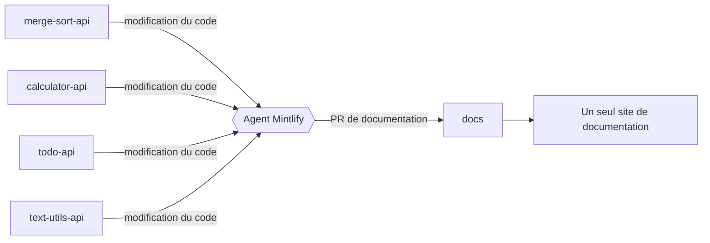

Bonne nouvelle : vous pouvez lire tout ce site sans exécuter quoi que ce soit. Flânez, survolez, hochez la tête d'un air pensif. Mais si vous voulez appuyer sur le rutilant bouton **Try it** et faire vraiment bouger les choses, il vous faudra une API qui ronronne sur votre ordinateur.

<Card type="tip">
  nouvelle fonctionnalité<br /><br /><br /><br />
</Card>

<Steps>
  <Step title="Rassemblez votre équipement d'aventurier">
    Vous avez besoin de Python 3.10 ou version ultérieure et de `git`. C'est tout. Pas de dragons, pas de pactes de sang.

    <Tabs>
      <Tab title="macOS">
        ```bash
        brew install python git
        ```
      </Tab>
      <Tab title="Linux">
        ```bash
        sudo apt install python3 python3-venv git
        ```
      </Tab>
      <Tab title="Windows">
        ```powershell
        winget install Python.Python.3.12 Git.Git
        ```
      </Tab>
    </Tabs>
  </Step>

  <Step title="Choisissez une API et réveillez-la">
    Choisissez votre combattant. Elles sont toutes adorables. Nous n'avons pas de favorite (pas à voix haute, en tout cas).

    <CodeGroup>
      ```bash Merge Sort API
      git clone https://github.com/mintlify-demo/merge-sort-api.git
      cd merge-sort-api
      python3 -m venv .venv && source .venv/bin/activate
      pip install -r requirements.txt
      uvicorn main:app --reload
      ```

      ```bash Calculator API
      git clone https://github.com/mintlify-demo/calculator-api.git
      cd calculator-api
      python3 -m venv .venv && source .venv/bin/activate
      pip install -r requirements.txt
      uvicorn main:app --reload
      ```

      ```bash Todo API
      git clone https://github.com/mintlify-demo/todo-api.git
      cd todo-api
      python3 -m venv .venv && source .venv/bin/activate
      pip install -r requirements.txt
      uvicorn main:app --reload
      ```

      ```bash Text Utils API
      git clone https://github.com/mintlify-demo/text-utils-api.git
      cd text-utils-api
      python3 -m venv .venv && source .venv/bin/activate
      pip install -r requirements.txt
      uvicorn main:app --reload
      ```
    </CodeGroup>

    <Warning>
      Toutes les API veulent le port `8000`, et elles ne savent pas partager. Exécutez-en une à la fois, ou envoyez les autres dans leur chambre avec `--port 8001`.
    </Warning>
  </Step>

  <Step title="Ouvrez sa référence d'API">
    Choisissez l'onglet correspondant en haut de ce site, sélectionnez un endpoint et écrasez **Try it** (doucement, c'est un bouton, pas une piñata). Le bac à sable envoie la requête depuis votre navigateur directement à `http://localhost:8000`. Sans intermédiaires ni pigeons voyageurs.
  </Step>

  <Step title="Envoyez une requête">
    Pour la Todo API, utilisez la clé d'API ultra-secrète `demo-key`. Surtout, ne le dites à personne. Toutes les autres API sont en libre accès et ne nécessitent aucune clé.
  </Step>
</Steps>

<Check>
  Regardez-vous ! Vous exécutez une vraie API et l'appelez depuis une documentation générée. Allez-y, racontez-le à votre mère.
</Check>

<Tip>
  Vous faites une démonstration en direct ? Démarrez l'API _avant_ l'appel (croyez-nous sur ce point) et laissez votre navigateur garé sur la page de l'endpoint. Le bac à sable, les exemples de code et la visionneuse de réponses se mettent tous à jour pendant la saisie, ce qui fait un effet du tonnerre.
</Tip>

## Dépannage {#troubleshooting}

Ça a mal tourné ? Ça arrive aux meilleurs d'entre nous.

<AccordionGroup>
  <Accordion title="Le bac à sable indique qu'il ne peut pas joindre le serveur">
    L'API tourne-t-elle vraiment ? Vérifiez que votre terminal affiche fièrement `Uvicorn running on http://127.0.0.1:8000`. Les API autorisent déjà les requêtes cross-origin, il n'y a donc aucune poignée de main secrète à configurer.
  </Accordion>
  <Accordion title="`pip install` échoue">
    Neuf fois sur dix, l'environnement virtuel n'est pas activé. Votre invite de commande doit commencer par `(.venv)`. Sinon, le venv fait la sieste. Réveillez-le et réessayez.
  </Accordion>
  <Accordion title="Le port 8000 est déjà utilisé">
    Quelqu'un a pris votre place. Arrêtez l'autre API, ou déménagez poliment avec `uvicorn main:app --port 8001`.
  </Accordion>
</AccordionGroup>

## Comment ce site est construit {#how-this-site-is-built}

Le code et les tests de chaque API se trouvent dans le propre dépôt de cette API, comme des adultes responsables. Toute la documentation, y compris les guides et la spécification OpenAPI de chaque API, se trouve réunie dans le [dépôt de la documentation](https://github.com/mintlify-demo/docs). Lorsque le code d'une API change, l'agent de Mintlify le remarque (il est très observateur) et ouvre une pull request dans le dépôt de la documentation avec la mise à jour correspondante. Personne n'a besoin de s'en souvenir. Personne n'a besoin de relancer qui que ce soit.



<Columns cols={2}>
  <Card title="Composants" icon="shapes" href="/fr/showcase/components">
    Toutes les briques de Lego utilisées pour construire ce site.
  </Card>
  <Card title="Fonctionnalités d'IA" icon="sparkles" href="/fr/showcase/ai">
    L'assistant, llms.txt, le serveur MCP et autres tours de magie robotique.
  </Card>
</Columns>
