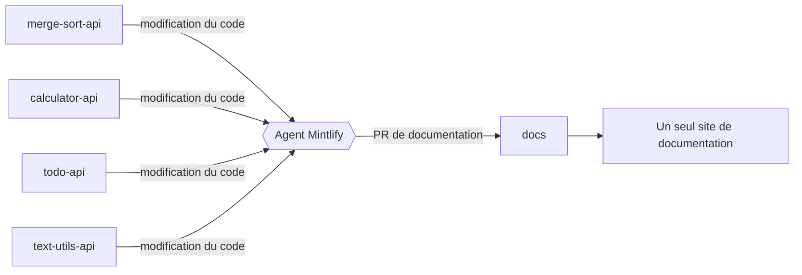

Vous pouvez lire tout ce site sans rien exécuter. Pour utiliser le bac à sable **Try it**, exécutez une API sur votre ordinateur.

changement

marco apporte des modifications

nouvelle ligne. test.

<Steps>
  <Step title="Vérifiez ce dont vous avez besoin">
    Vous avez besoin de Python 3.10 ou version ultérieure et de `git`.

    <Tabs>
      <Tab title="macOS">
        ```bash
        brew install python git
        ```
      </Tab>
      <Tab title="Linux">
        ```bash
        sudo apt install python3 python3-venv git
        ```
      </Tab>
      <Tab title="Windows">
        ```powershell
        winget install Python.Python.3.12 Git.Git
        ```
      </Tab>
    </Tabs>
  </Step>

  <Step title="Choisissez une API et démarrez-la">
    <CodeGroup>
      ```bash Sort API
      git clone https://github.com/mintlify-demo/merge-sort-api.git
      cd merge-sort-api
      python3 -m venv .venv && source .venv/bin/activate
      pip install -r requirements.txt
      uvicorn main:app --reload
      ```

      ```bash Calculator API
      git clone https://github.com/mintlify-demo/calculator-api.git
      cd calculator-api
      python3 -m venv .venv && source .venv/bin/activate
      pip install -r requirements.txt
      uvicorn main:app --reload
      ```

      ```bash Todo API
      git clone https://github.com/mintlify-demo/todo-api.git
      cd todo-api
      python3 -m venv .venv && source .venv/bin/activate
      pip install -r requirements.txt
      uvicorn main:app --reload
      ```

      ```bash Text Utils API
      git clone https://github.com/mintlify-demo/text-utils-api.git
      cd text-utils-api
      python3 -m venv .venv && source .venv/bin/activate
      pip install -r requirements.txt
      uvicorn main:app --reload
      ```
    </CodeGroup>

    <Warning>
      Toutes les API utilisent le port `8000`. Exécutez-en une à la fois, ou démarrez les autres avec `--port 8001`.
    </Warning>
  </Step>

  <Step title="Ouvrez sa référence d'API">
    Choisissez l'onglet correspondant en haut de ce site, sélectionnez un endpoint et cliquez sur **Try it**. Le bac à sable envoie la requête depuis votre navigateur directement à `http://localhost:8000`.
  </Step>

  <Step title="Envoyez une requête">
    Pour la Todo API, saisissez `demo-key` comme clé d'API. Aucune autre API ne nécessite de clé.
  </Step>
</Steps>

<Check>
  Vous exécutez une vraie API et l'appelez depuis une documentation générée.
</Check>

<Tip>
  Vous faites une démonstration en direct ? Démarrez l'API avant l'appel et gardez votre navigateur sur la page de l'endpoint. Le bac à sable, les exemples de code et la visionneuse de réponses se mettent tous à jour pendant la saisie.
</Tip>

## Dépannage {#troubleshooting}

<AccordionGroup>
  <Accordion title="Le bac à sable indique qu'il ne peut pas joindre le serveur">
    Assurez-vous que l'API est en cours d'exécution et affiche `Uvicorn running on http://127.0.0.1:8000`. Les API autorisent les requêtes cross-origin, aucune configuration supplémentaire n'est donc nécessaire.
  </Accordion>
  <Accordion title="`pip install` échoue">
    Vérifiez que vous avez activé l'environnement virtuel : votre invite de commande doit commencer par `(.venv)`.
  </Accordion>
  <Accordion title="Le port 8000 est déjà utilisé">
    Arrêtez l'autre API, ou exécutez `uvicorn main:app --port 8001`.
  </Accordion>
</AccordionGroup>

## Comment ce site est construit {#how-this-site-is-built}

Le code et les tests de chaque API se trouvent dans le dépôt de cette API. Toute la documentation, y compris les guides et la spécification OpenAPI de chaque API, se trouve dans le [dépôt de la documentation](https://github.com/mintlify-demo/docs). Lorsque le code d'une API change, l'agent de Mintlify ouvre une pull request dans le dépôt de la documentation avec la mise à jour correspondante.



<Columns cols={2}>
  <Card title="Composants" icon="shapes" href="/fr/showcase/components">
    Tous les éléments de base utilisés sur ce site.
  </Card>
  <Card title="Fonctionnalités d'IA" icon="sparkles" href="/fr/showcase/ai">
    L'assistant, llms.txt, le serveur MCP et plus encore.
  </Card>
</Columns>
