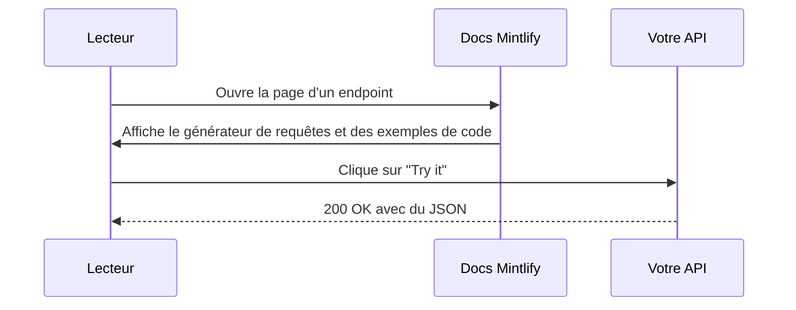
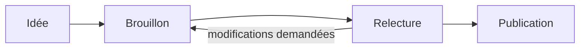

Chaque exemple de cette page est du vrai MDX. Utilisez l'option **Afficher en Markdown** de la page pour copier n'importe lequel d'entre eux.

## Encadrés

<Note>Une **note** ajoute du contexte.</Note>
<Tip>Une **astuce** partage un raccourci ou une bonne pratique.</Tip>
<Info>Un encadré **info** met en avant une information utile.</Info>
<Check>Une **validation** confirme une réussite.</Check>
<Warning>Un **avertissement** signale un point d'attention.</Warning>
<Danger>Un encadré **danger** signale ce qui peut tout casser.</Danger>

## Cartes

<CardGroup cols={3}>
  <Card title="Carte simple" icon="star">
    Une carte avec une icône et du texte.
  </Card>
  <Card title="Carte avec lien" icon="link" href="/fr/quickstart">
    Ajoutez `href` et toute la carte devient cliquable.
  </Card>
  <Card title="Carte avec CTA" icon="arrow-right" href="/fr/changelog" cta="Voir le journal des modifications">
    Ajoutez `cta` pour personnaliser le libellé du lien.
  </Card>
</CardGroup>

<Card title="Carte horizontale" icon="grip-lines" horizontal>
  Utilisez `horizontal` pour une mise en page compacte, en pleine largeur.
</Card>

## Colonnes

<Columns cols={2}>
  <Card title="Colonne de gauche" icon="arrow-left">Les colonnes disposent n'importe quel contenu dans une grille adaptative.</Card>
  <Card title="Colonne de droite" icon="arrow-right">Elles s'empilent sur les petits écrans.</Card>
</Columns>

## Étapes

<Steps>
  <Step title="Première étape" icon="1">
    Les étapes numérotent une procédure automatiquement.
  </Step>
  <Step title="Deuxième étape">
    Une étape peut contenir n'importe quoi, y compris du code :

    ```bash
    echo "bonjour depuis une étape"
    ```
  </Step>
  <Step title="Troisième étape">
    Terminé.
  </Step>
</Steps>

## Onglets

<Tabs>
  <Tab title="Premier onglet" icon="1">
    Les onglets permettent de passer d'une option à l'autre, comme des systèmes d'exploitation ou des langages.
  </Tab>
  <Tab title="Deuxième onglet" icon="2">
    Le choix du lecteur est mémorisé sur toutes les pages qui utilisent les mêmes titres d'onglets.
  </Tab>
</Tabs>

## Groupes de code et blocs de code

<CodeGroup>
  ```python Python
  def greet(name: str) -> str:
      return f"Hello, {name}!"
  ```

  ```javascript JavaScript
  const greet = (name) => `Hello, ${name}!`;
  ```

  ```go Go
  func greet(name string) string { return "Hello, " + name + "!" }
  ```
</CodeGroup>

```python title="highlight.py" lines highlight={2,3}
def total(items):
    subtotal = sum(items)       # surligné
    return subtotal * 1.08      # surligné
```

## Accordéons

<AccordionGroup>
  <Accordion title="Fermé par défaut" icon="chevron-down">
    Les accordéons masquent les détails jusqu'à ce que le lecteur en ait besoin.
  </Accordion>
  <Accordion title="Ouvert par défaut" defaultOpen>
    Utilisez `defaultOpen` pour qu'il soit déplié au départ.
  </Accordion>
</AccordionGroup>

## Diagrammes avec Mermaid

Écrivez un bloc `mermaid` et Mintlify le dessine, en mode clair comme en mode sombre.



Les organigrammes fonctionnent de la même façon.



## Champs d'API

<ParamField path="user_id" type="string" required>
  L'ID de l'utilisateur. Les paramètres de chemin, les paramètres de requête, les en-têtes et les champs du corps ont chacun leur variante.
</ParamField>

<ParamField query="limit" type="integer" default="10">
  Nombre maximal de résultats.
</ParamField>

<ResponseField name="user" type="object" required>
  L'objet utilisateur.

  <Expandable title="propriétés">
    <ResponseField name="name" type="string">Le nom de l'utilisateur.</ResponseField>
    <ResponseField name="plan" type="string" default="free">L'offre de l'utilisateur.</ResponseField>
  </Expandable>
</ResponseField>

## Exemples de requête et de réponse

<RequestExample>
  ```bash Requête
  curl https://api.example.com/users/42
  ```
</RequestExample>

<ResponseExample>
  ```json Réponse
  { "user": { "name": "Ada", "plan": "free" } }
  ```
</ResponseExample>

## Cadres et images

<Frame caption="Une image SVG dans un Frame, avec une légende.">
  
</Frame>

## Badges, infobulles et icônes

<Badge color="green" icon="circle-check">Stable</Badge> <Badge color="orange" icon="clock">Bêta</Badge> <Badge color="red" icon="ban">Obsolète</Badge> <Badge color="blue" stroke>Contour</Badge> <Badge color="purple" shape="pill">Pilule</Badge>

Survolez <Tooltip headline="OpenAPI" tip="Un format standard pour décrire les API HTTP. Mintlify le transforme en référence d'API interactive.">OpenAPI</Tooltip> pour voir une infobulle.

Icônes dans le texte : <Icon icon="rocket" size={16} /> <Icon icon="bolt" size={16} color="#0D9373" /> <Icon icon="heart" size={16} color="#EF4444" />

## Arborescence

<Tree>
  <Tree.Folder name="merge-sort-api" defaultOpen>
    <Tree.File name="main.py" />
    <Tree.File name="requirements.txt" />
    <Tree.Folder name="tests">
      <Tree.File name="test_main.py" />
    </Tree.Folder>
    <Tree.Folder name="docs" defaultOpen>
      <Tree.File name="docs.json" />
      <Tree.File name="index.mdx" />
      <Tree.File name="openapi.json" />
    </Tree.Folder>
  </Tree.Folder>
</Tree>

## Couleurs

<Color variant="compact">
  <Color.Item name="primary" value="#0D9373" />
  <Color.Item name="light" value="#55D799" />
  <Color.Item name="surface" value={{ light: "#F8FAFC", dark: "#0F172A" }} />
</Color>

## Carte de dépôt GitHub

<GitHub.Repo repo="mintlify/docs" />

## Prompt

<Prompt description="Donnez-le à votre agent de code pour qu'il écrive la doc dans votre style.">
Vous êtes rédacteur technique. Rédigez une documentation claire et concise pour les développeurs.
- Utilisez la deuxième personne ("vous") et des verbes à la voix active.
- Commencez chaque procédure par un titre orienté objectif.
- Montrez un exemple de code exécutable pour chaque endpoint.
</Prompt>

## Vues

<View title="Python" icon="python">
  ```python
  print("Les vues changent le contenu de toute la page.")
  ```
</View>

<View title="JavaScript" icon="js">
  ```javascript
  console.log("Choisissez un langage et la page change.");
  ```
</View>

## Mathématiques

Des maths dans le texte comme $E = mc^2$ et en bloc :

$$
\sum_{i=1}^{n} i = \frac{n(n+1)}{2}
$$

## Tableaux et Markdown

| Fonctionnalité | Free | Pro | Enterprise |
| --- | :---: | :---: | :---: |
| Hébergement de la doc | Oui | Oui | Oui |
| Assistant IA | | Oui | Oui |
| Projets multi-dépôts | | | Oui |

> Les citations, le **gras**, l'*italique*, le ~~barré~~, le `code en ligne` et les [liens](/fr/quickstart) fonctionnent comme prévu.

- [x] Les listes de tâches
- [ ] fonctionnent aussi

<Panel>
  <Info>
    Un **Panel** épingle du contenu sur le côté droit de la page. Utilisez-le pour des exemples, des résumés ou des liens.
  </Info>
</Panel>
