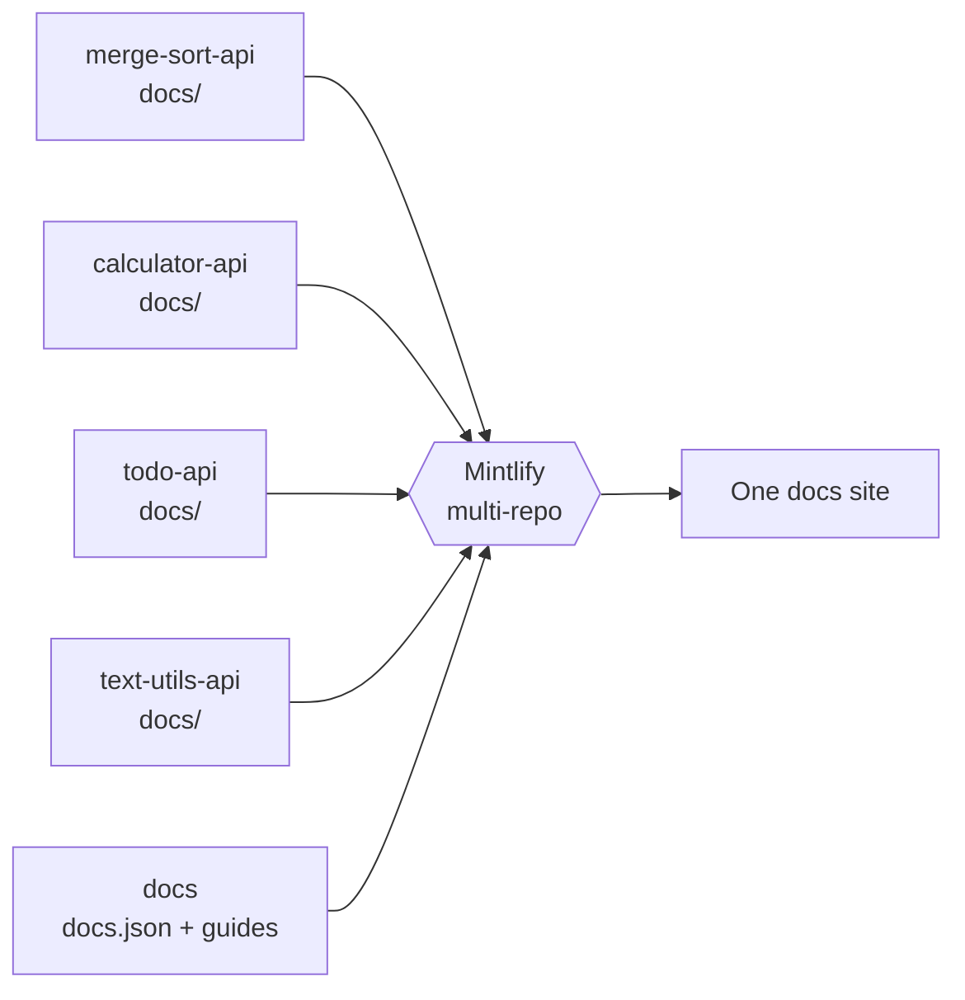

<Note>
  This site is a **demo for Mintlify account executives**. Everything here is real: the API references are generated from OpenAPI files, and each API's docs live in that API's own repository.
</Note>

## Start here

<CardGroup cols={2}>
  <Card title="Quickstart" icon="rocket" href="/quickstart">
    Run the demo APIs on your laptop and try them from the docs.
  </Card>
  <Card title="Component tour" icon="shapes" href="/showcase/components">
    Every building block: cards, steps, tabs, diagrams, API fields, and more.
  </Card>
  <Card title="AI features" icon="sparkles" href="/showcase/ai">
    The assistant, llms.txt, the MCP server, skill.md, and the contextual menu.
  </Card>
  <Card title="Changelog" icon="clock-rotate-left" href="/changelog">
    How a changelog looks, with an RSS feed for free.
  </Card>
</CardGroup>

## Four example APIs

Each tab at the top is a separate repository with its own code, tests, OpenAPI spec and docs. Mintlify combines them into one site.

<Columns cols={2}>
  <Card title="Sort API" icon="arrow-down-wide-short" href="../merge-sort-api">
    Sort numbers with quick sort and see every partition step. Good for showing a diagram and a simple playground.
  </Card>
  <Card title="Calculator API" icon="calculator" href="../calculator-api">
    v1 and v2 side by side, with typed `400` errors.
  </Card>
  <Card title="Todo API" icon="list-check" href="../todo-api">
    API-key auth, pagination, and a deprecated endpoint.
  </Card>
  <Card title="Text Utils API" icon="font" href="../text-utils-api">
    Code samples in four languages, written in the OpenAPI spec.
  </Card>
</Columns>

## How this demo is built

<AccordionGroup>
  <Accordion title="Why separate repositories?">
    That's how many customers work: the API team owns the API repo and its docs, and a central docs repo owns the site settings and the guides. A push to any repo updates the site.
  </Accordion>
  <Accordion title="What lives in this repo?">
    Site settings (`docs.json`: theme, colors, logo, navigation), the landing page, the guides, the showcase pages and the changelog.
  </Accordion>
  <Accordion title="Where do I change an API's docs?">
    In that API's repository, in the `docs/` folder. This repo only decides **where** each API appears.
  </Accordion>
</AccordionGroup>
