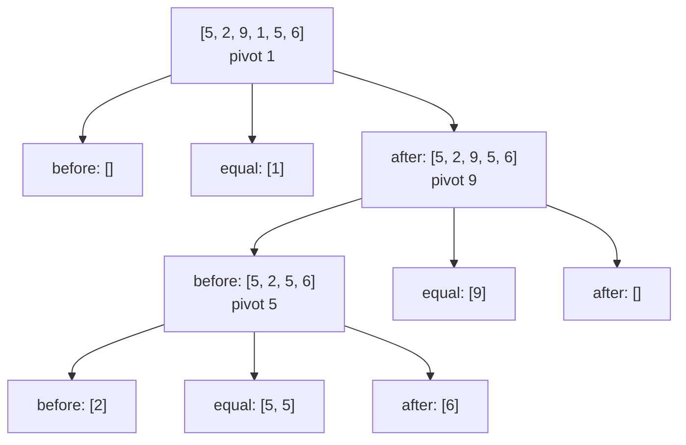

Quick sort is a **divide and conquer** algorithm. It picks one item as the **pivot**, splits the rest of the list into items that come before it and items that come after it, then sorts each side the same way. A list with zero or one item is already sorted, so the recursion stops there.

## The idea

The Sort API always picks the **middle** item as the pivot. It then splits the list into three groups:

- `before`: items that sort before the pivot
- `equal`: items equal to the pivot
- `after`: items that sort after the pivot

Quick sort then sorts `before` and `after`, and joins `before + equal + after`.



## Partitioning a list

Partitioning is the only real work. Compare each item to the pivot and put it in one of the three groups.

<Steps>
  <Step title="Pick the pivot">
    For `[5, 2, 5, 6]`, the middle item is at index 2, so the pivot is `5`.
  </Step>
  <Step title="Split around the pivot">
    `2` is smaller, so it goes in `before`. Both `5`s go in `equal`. `6` is larger, so it goes in `after`.
  </Step>
  <Step title="Sort each side and join">
    `[2]` and `[6]` have one item each, so they're already sorted. Join them: `[2] + [5, 5] + [6]` = `[2, 5, 5, 6]`.
  </Step>
</Steps>

When `order` is `desc`, the groups flip. Larger items go in `before` and smaller items go in `after`.

## See it with the API

Ask `/sort/steps` to sort `[5, 2, 9, 1, 5, 6]` and it returns every partition:

<CodeGroup>
  ```bash Request
  curl -X POST http://localhost:8000/sort/steps \
    -H "Content-Type: application/json" \
    -d '{"numbers": [5, 2, 9, 1, 5, 6]}'
  ```

  ```json Response
  {
    "result": [1, 2, 5, 5, 6, 9],
    "count": 6,
    "order": "asc",
    "steps": [
      { "step": 1, "pivot": 1, "before": [], "equal": [1], "after": [5, 2, 9, 5, 6] },
      { "step": 2, "pivot": 9, "before": [5, 2, 5, 6], "equal": [9], "after": [] },
      { "step": 3, "pivot": 5, "before": [2], "equal": [5, 5], "after": [6] }
    ]
  }
  ```
</CodeGroup>

Steps are listed depth-first. The API fully partitions the `before` side of a step before it starts on the `after` side. Lists with zero or one item don't produce a step.

<Info>
  Quick sort runs in O(n log n) time on average. In the worst case, when the pivot keeps landing at one end of the list, it takes O(n²) time.
</Info>

<Warning>
  Version 2.0.0 changed the shape of each step. Steps used to contain `left`, `right`, and `merged`. They now contain `pivot`, `before`, `equal`, and `after`. Update any code that reads `steps` from `/sort/steps`.
</Warning>

<Expandable title="Read the code">
  The whole algorithm is a recursive `quick_sort()` function in `main.py`. It picks the middle item, builds the `before`, `equal`, and `after` groups, and calls itself on `before` and `after`.
</Expandable>

Ready to try it? Head to the [quickstart](/merge-sort-api/quickstart).
