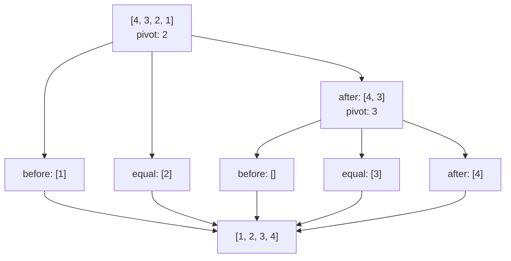

Quick sort is a **divide and conquer** algorithm. It picks one item as the **pivot**, splits the rest of the list into items that come before the pivot and items that come after it, and then sorts each side the same way. A list with zero or one item is already sorted, so the recursion stops there.

## The idea



## Partitioning around a pivot

Partitioning is the only real work. The API always picks the **middle item** as the pivot and splits the list into three groups.

<Steps>
  <Step title="Pick the pivot">
    For `[4, 3, 2, 1]`, the middle item (index `4 // 2 = 2`) is `2`.
  </Step>
  <Step title="Split into three groups">
    `before = [1]`, `equal = [2]`, and `after = [4, 3]`. The `before` and `after` groups are not sorted yet.
  </Step>
  <Step title="Sort each side and join">
    Quick sort the `before` and `after` groups the same way, then join `before + equal + after`.
  </Step>
</Steps>

When you send `"order": "desc"`, the groups flip. Items larger than the pivot go in `before`, and smaller items go in `after`.

## See it with the API

Ask `/sort/steps` to sort `[4, 3, 2, 1]` and it returns every partition:

<CodeGroup>
  ```bash Request
  curl -X POST http://localhost:8000/sort/steps \
    -H "Content-Type: application/json" \
    -d '{"numbers": [4, 3, 2, 1]}'
  ```

  ```json Response
  {
    "result": [1, 2, 3, 4],
    "count": 4,
    "order": "asc",
    "algorithm": "quick",
    "steps": [
      { "step": 1, "pivot": 2, "before": [1], "equal": [2], "after": [4, 3] },
      { "step": 2, "pivot": 3, "before": [], "equal": [3], "after": [4] }
    ]
  }
  ```
</CodeGroup>

Each step has these fields:

| Field | Description |
| --- | --- |
| `step` | 1-based position of this partition in the run |
| `pivot` | The value the list was split around (the middle item) |
| `before` | Items that sort before the pivot, still unsorted |
| `equal` | Items equal to the pivot |
| `after` | Items that sort after the pivot, still unsorted |

Steps are listed depth-first. The API fully partitions the `before` side before it starts on the `after` side. Lists with zero or one item need no partition, so they don't appear as steps.

<Info>
  Quick sort runs in O(n log n) time on average and O(n²) in the worst case.
</Info>

<Warning>
  Version 2.0.0 replaced merge sort with quick sort. `/sort/steps` no longer returns `left`, `right`, and `merged`. If you parse steps, read `pivot`, `before`, `equal`, and `after` instead. `/sort` returns the same response shape as before.
</Warning>

<Expandable title="Read the code">
  The whole algorithm is a single recursive `quick_sort()` function in `main.py`. It picks the middle item as the pivot, builds the `before`, `equal`, and `after` lists, and calls itself on `before` and `after`.
</Expandable>

Ready to try it? Head to the [quickstart](/merge-sort-api/quickstart).
