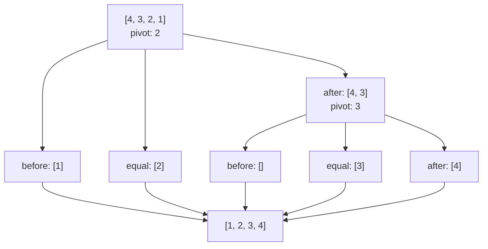

Quick sort is a **divide and conquer** algorithm. It picks one item as the **pivot**, splits the rest of the list into items that come before the pivot and items that come after it, and then sorts each side the same way. A piece with zero or one item is already sorted, so the recursion stops there.

<Warning>
  Version 2.0.0 of the API switched from merge sort to quick sort. `/sort` still returns the same sorted `result`, but each item in the `/sort/steps` response now has `pivot`, `before`, `equal`, and `after` fields instead of `left`, `right`, and `merged`. Update any client code that reads `steps`.
</Warning>

## The idea



## Partitioning around a pivot

Partitioning is the only real work. The API picks the middle item as the pivot and sorts every item into one of three groups.

<Steps>
  <Step title="Pick the pivot">
    For `[4, 3, 2, 1]`, the middle item (index `4 // 2 = 2`) is `2`.
  </Step>
  <Step title="Split into three groups">
    Items smaller than `2` go to `before: [1]`. Items equal to `2` go to `equal: [2]`. Items larger than `2` go to `after: [4, 3]`.
  </Step>
  <Step title="Sort each side and join">
    Quick sort `before` and `after` the same way, then join `before + equal + after`. Groups with zero or one item need no more work.
  </Step>
</Steps>

<Tip>
  With `"order": "desc"`, the groups flip. Items larger than the pivot go to `before` and smaller items go to `after`.
</Tip>

## See it with the API

Ask `/sort/steps` to sort `[4, 3, 2, 1]` and it returns every partition:

<CodeGroup>
  ```bash Request
  curl -X POST http://localhost:8000/sort/steps \
    -H "Content-Type: application/json" \
    -d '{"numbers": [4, 3, 2, 1]}'
  ```

  ```json Response
  {
    "result": [1, 2, 3, 4],
    "count": 4,
    "order": "asc",
    "steps": [
      { "step": 1, "pivot": 2, "before": [1], "equal": [2], "after": [4, 3] },
      { "step": 2, "pivot": 3, "before": [], "equal": [3], "after": [4] }
    ]
  }
  ```
</CodeGroup>

Each step records one partition:

| Field | Description |
| --- | --- |
| `step` | 1-based position of this partition in the run |
| `pivot` | The value the list was split around (the middle item) |
| `before` | Items that sort before the pivot, still unsorted |
| `equal` | Items equal to the pivot |
| `after` | Items that sort after the pivot, still unsorted |

Steps are listed depth-first. The `before` side is fully partitioned before the `after` side starts. Groups with zero or one item don't get their own step.

<Info>
  Quick sort runs in O(n log n) time on average and O(n²) in the worst case. Unlike the previous merge sort implementation, it isn't described as a stable sort.
</Info>

<Expandable title="Read the code">
  The whole algorithm is a single recursive `quick_sort()` function in `main.py`. It picks the middle item as the pivot, builds the `before`, `equal`, and `after` lists, and returns `quick_sort(before) + equal + quick_sort(after)`.
</Expandable>

Ready to try it? Head to the [quickstart](/merge-sort-api/quickstart).
