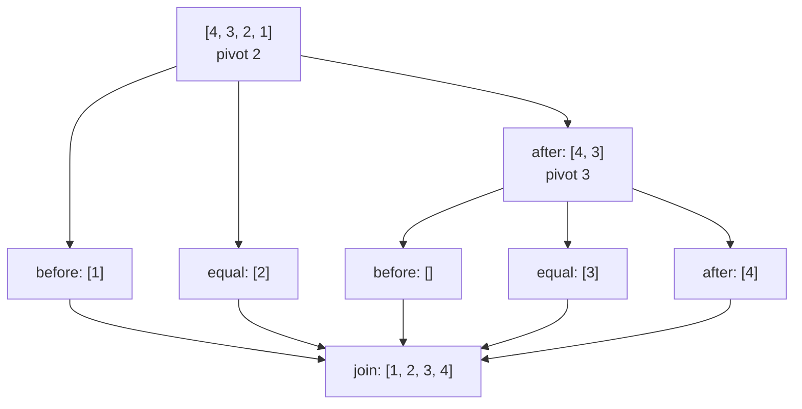

Quick sort is a **divide and conquer** algorithm. It picks one item as the **pivot**, splits the rest of the list around it, then sorts each side the same way. A list with zero or one item is already sorted, so the recursion stops there.

## The idea

The Sort API always picks the **middle** item as the pivot. It then partitions the list into three groups:

- `before`: items that sort before the pivot
- `equal`: items equal to the pivot
- `after`: items that sort after the pivot



## Partitioning a list

Partitioning is the only real work. Compare every item to the pivot and drop it into one of the three groups.

<Steps>
  <Step title="Pick the pivot">
    For `[4, 3, 2, 1]`, the middle item (index 2) is `2`.
  </Step>
  <Step title="Split around the pivot">
    `1` goes to `before`, `2` goes to `equal`, and `4` and `3` go to `after`. The groups are not sorted yet.
  </Step>
  <Step title="Sort each side and join">
    Quick sort the `before` and `after` groups the same way. Then join `before + equal + after`.
  </Step>
</Steps>

When you send `"order": "desc"`, the groups flip. `before` holds larger items and `after` holds smaller ones.

## See it with the API

Ask `/sort/steps` to sort `[4, 3, 2, 1]` and it returns every partition:

<CodeGroup>
  ```bash Request
  curl -X POST http://localhost:8000/sort/steps \
    -H "Content-Type: application/json" \
    -d '{"numbers": [4, 3, 2, 1]}'
  ```

  ```json Response
  {
    "result": [1, 2, 3, 4],
    "count": 4,
    "order": "asc",
    "steps": [
      { "step": 1, "pivot": 2, "before": [1], "equal": [2], "after": [4, 3] },
      { "step": 2, "pivot": 3, "before": [], "equal": [3], "after": [4] }
    ]
  }
  ```
</CodeGroup>

Steps are listed depth-first. The `before` side is fully partitioned before the `after` side starts. Groups with zero or one item need no partition, so they don't produce a step. A single-item list returns an empty `steps` array.

<Info>
  Quick sort runs in O(n log n) time on average and O(n²) in the worst case. Picking the middle item keeps already sorted and reverse-sorted lists fast.
</Info>

<Warning>
  Version 2.0.0 replaced merge steps with partition steps. Each step now has `pivot`, `before`, `equal`, and `after` instead of `left`, `right`, and `merged`. Update any client that reads `steps`.
</Warning>

<Expandable title="Read the code">
  The whole algorithm is a single recursive `quick_sort()` function in `main.py`. It picks the middle pivot, builds the three groups, and calls itself on `before` and `after`.
</Expandable>

Ready to try it? Head to the [quickstart](/merge-sort-api/quickstart).
