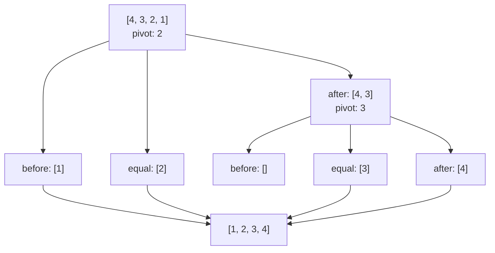

Quick sort is a **divide and conquer** algorithm. It picks one item as the **pivot** and splits the rest of the list around it. Then it sorts each side the same way until every piece has at most one item.

## The idea

The Sort API always picks the middle item as the pivot. It then partitions the list into three groups:

- `before`: items that sort before the pivot
- `equal`: items equal to the pivot
- `after`: items that sort after the pivot



## Partitioning a list

Partitioning is the only real work. Compare every item to the pivot and drop it into one of the three groups.

<Steps>
  <Step title="Pick the pivot">
    For `[5, 2, 5, 6]`, the middle item is `5`.
  </Step>
  <Step title="Split around it">
    `2` goes to `before`. Both `5`s go to `equal`. `6` goes to `after`.
  </Step>
  <Step title="Sort each side and join">
    Quick sort `before` and `after`, then join them: `[2] + [5, 5] + [6]`.
  </Step>
</Steps>

With `"order": "desc"`, larger items go to `before` and smaller items go to `after`.

## See it with the API

Ask `/sort/steps` to sort `[5, 2, 9, 1, 5, 6]` and it returns every partition:

<CodeGroup>
  ```bash Request
  curl -X POST http://localhost:8000/sort/steps \
    -H "Content-Type: application/json" \
    -d '{"numbers": [5, 2, 9, 1, 5, 6]}'
  ```

  ```json Response
  {
    "result": [1, 2, 5, 5, 6, 9],
    "count": 6,
    "order": "asc",
    "steps": [
      { "step": 1, "pivot": 1, "before": [], "equal": [1], "after": [5, 2, 9, 5, 6] },
      { "step": 2, "pivot": 9, "before": [5, 2, 5, 6], "equal": [9], "after": [] },
      { "step": 3, "pivot": 5, "before": [2], "equal": [5, 5], "after": [6] }
    ]
  }
  ```
</CodeGroup>

Each step records one partition. The `before` and `after` groups are still unsorted at that point. Steps are listed depth-first, so the API fully partitions the `before` side before it starts on the `after` side. Lists with one item or fewer need no partition, so they don't appear as steps.

<Info>
  Quick sort runs in O(n log n) time on average and O(n²) in the worst case. The worst case happens when the pivot keeps landing at one end of the list.
</Info>

<Warning>
  Version 2.0.0 replaced merge sort with quick sort. `/sort/steps` now returns `pivot`, `before`, `equal`, and `after` for each step. The old `left`, `right`, and `merged` fields are gone. Update any client that reads the steps.
</Warning>

<Expandable title="Read the code">
  The whole algorithm is one recursive `quick_sort()` function in `main.py`. It picks the middle item as the pivot, builds the three groups, and calls itself on `before` and `after`.
</Expandable>

Ready to try it? Head to the [quickstart](/merge-sort-api/quickstart).
