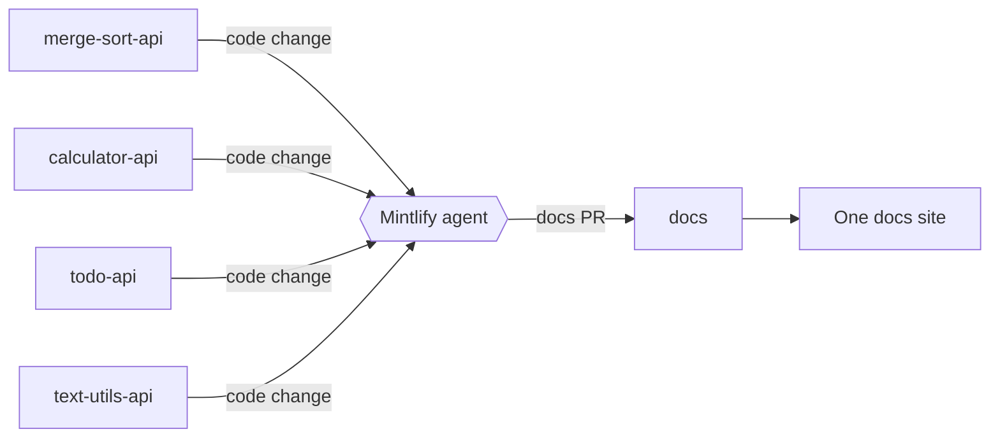

Good news: you can read this whole site without running a single thing. Lounge around, skim, nod thoughtfully. But if you want to press the shiny **Try it** button and actually make something happen, you'll need an API humming away on your laptop.<br /><br />

<Card type="tip">
  new feature 
</Card>

<Steps>
  <Step title="GatherYou need Python 3.10 or newer and `git`. That's it. No dragons, no blood oaths.">
    <Tabs>
      <Tab title="macOS">
        ```bash
        brew install python git
        ```
      </Tab>
      <Tab title="Linux">
        ```bash
        sudo apt install python3 python3-venv git
        ```
      </Tab>
      <Tab title="Windows">
        ```powershell
        winget install Python.Python.3.12 Git.Git
        ```
      </Tab>
    </Tabs>
  </Step>

  <Step title="Pick an API and wake it up">
    Choose your fighter. They're all lovely. We don't play favorites (out loud).

    <CodeGroup>
      ```bash Merge Sort API
      git clone https://github.com/mintlify-demo/merge-sort-api.git
      cd merge-sort-api
      python3 -m venv .venv && source .venv/bin/activate
      pip install -r requirements.txt
      uvicorn main:app --reload
      ```

      ```bash Calculator API
      git clone https://github.com/mintlify-demo/calculator-api.git
      cd calculator-api
      python3 -m venv .venv && source .venv/bin/activate
      pip install -r requirements.txt
      uvicorn main:app --reload
      ```

      ```bash Todo API
      git clone https://github.com/mintlify-demo/todo-api.git
      cd todo-api
      python3 -m venv .venv && source .venv/bin/activate
      pip install -r requirements.txt
      uvicorn main:app --reload
      ```

      ```bash Text Utils API
      git clone https://github.com/mintlify-demo/text-utils-api.git
      cd text-utils-api
      python3 -m venv .venv && source .venv/bin/activate
      pip install -r requirements.txt
      uvicorn main:app --reload
      ```
    </CodeGroup>

    <Warning>
      Every API wants port `8000`, and they do not share nicely. Run one at a time, or send the extras to their own room with `--port 8001`.
    </Warning>
  </Step>

  <Step title="Open its API reference">
    Pick the matching tab at the top of this site, choose an endpoint, and smash **Try it** (gently, it's a button, not a piñata). The playground fires the request from your browser straight to `http://localhost:8000`. No middlemen, no carrier pigeons.
  </Step>

  <Step title="Send a request">
    For the Todo API, use the top-secret API key `demo-key`. Please don't tell anyone. Every other API is a free-for-all and needs no key at all.
  </Step>
</Steps>

<Check>
  Look at you! You're running a real API and calling it from generated docs. Go ahead, tell your mom.
</Check>

<Tip>
  Showing this off live? Start the API _before_ the call (trust us on this one), and keep your browser parked on the endpoint page. The playground, the code samples and the response viewer all update as you type, which looks extremely impressive.
</Tip>

## Troubleshooting

Things went sideways? Happens to the best of us.

<AccordionGroup>
  <Accordion title="The playground says it can't reach the server">
    Is the API actually running? Check that your terminal proudly says `Uvicorn running on http://127.0.0.1:8000`. The APIs already allow cross-origin requests, so there's no secret handshake to configure.
  </Accordion>
  <Accordion title="`pip install` fails">
    Nine times out of ten, the virtual environment isn't activated. Your prompt should start with `(.venv)`. If it doesn't, the venv is napping. Wake it up and try again.
  </Accordion>
  <Accordion title="Port 8000 is already in use">
    Someone's sitting in your seat. Stop the other API, or politely relocate with `uvicorn main:app --port 8001`.
  </Accordion>
</AccordionGroup>

## How this site is built

Each API's code and tests live in that API's own repository, like responsible adults. All of the docs, including each API's guides and OpenAPI spec, live together in the [docs repository](https://github.com/mintlify-demo/docs). When an API's code changes, Mintlify's agent notices (it's very observant) and opens a pull request in the docs repository with the matching docs update. Nobody has to remember. Nobody has to nag.



<Columns cols={2}>
  <Card title="Components" icon="shapes" href="/showcase/components">
    Every Lego brick used to build this site.
  </Card>
  <Card title="AI features" icon="sparkles" href="/showcase/ai">
    The assistant, llms.txt, the MCP server and other robot magic.
  </Card>
</Columns>
