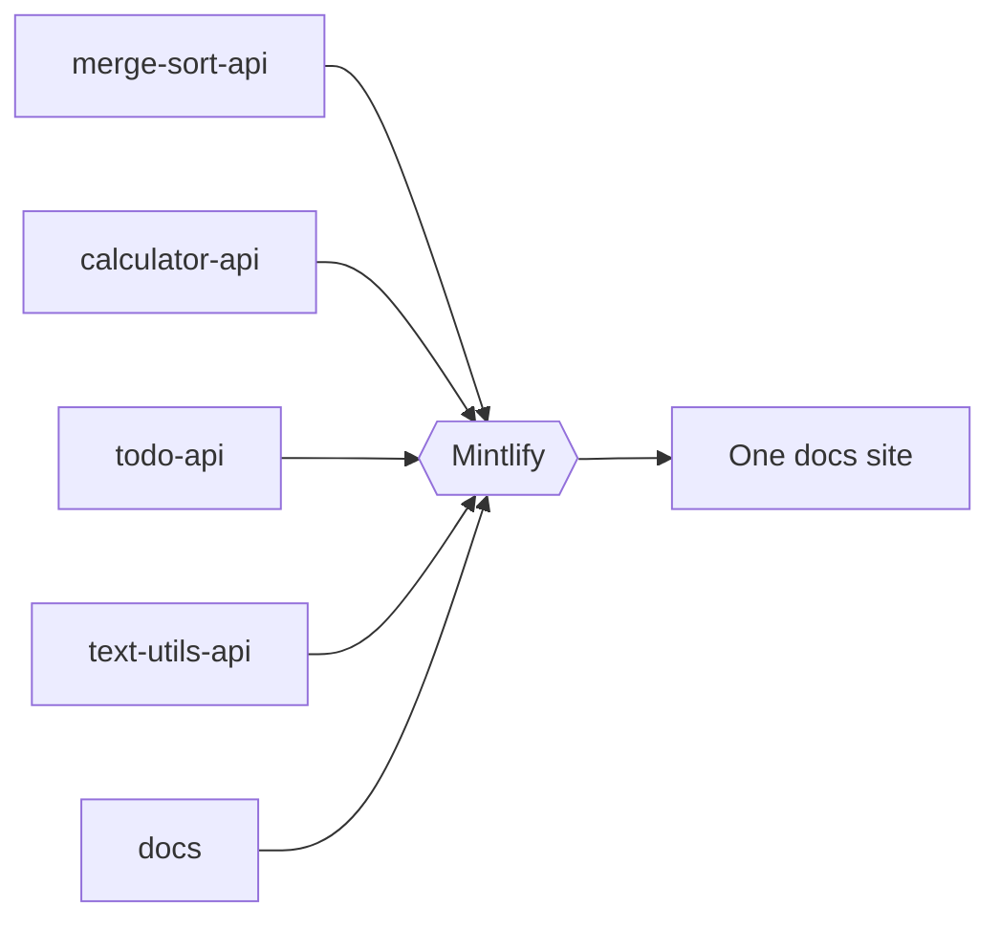

You can read this whole site without running anything. To use the **Try it** playground, run an API on your laptop.

<Steps>
  <Step title="Check what you need">
    You need Python 3.10 or newer and `git`.

    <Tabs>
      <Tab title="macOS">
        ```bash
        brew install python git
        ```
      </Tab>
      <Tab title="Linux">
        ```bash
        sudo apt install python3 python3-venv git
        ```
      </Tab>
      <Tab title="Windows">
        ```powershell
        winget install Python.Python.3.12 Git.Git
        ```
      </Tab>
    </Tabs>
  </Step>

  <Step title="Pick an API and start it">
    <CodeGroup>
      ```bash Sort API
      git clone https://github.com/mintlify-demo/merge-sort-api.git
      cd merge-sort-api
      python3 -m venv .venv && source .venv/bin/activate
      pip install -r requirements.txt
      uvicorn main:app --reload
      ```

      ```bash Calculator API
      git clone https://github.com/mintlify-demo/calculator-api.git
      cd calculator-api
      python3 -m venv .venv && source .venv/bin/activate
      pip install -r requirements.txt
      uvicorn main:app --reload
      ```

      ```bash Todo API
      git clone https://github.com/mintlify-demo/todo-api.git
      cd todo-api
      python3 -m venv .venv && source .venv/bin/activate
      pip install -r requirements.txt
      uvicorn main:app --reload
      ```

      ```bash Text Utils API
      git clone https://github.com/mintlify-demo/text-utils-api.git
      cd text-utils-api
      python3 -m venv .venv && source .venv/bin/activate
      pip install -r requirements.txt
      uvicorn main:app --reload
      ```
    </CodeGroup>

    <Warning>
      Every API uses port `8000`. Run one at a time, or start others with `--port 8001`.
    </Warning>
  </Step>

  <Step title="Open its API reference">
    Choose the matching tab at the top of this site, pick an endpoint, and click **Try it**. The playground sends the request from your browser straight to `http://localhost:8000`.
  </Step>

  <Step title="Send a request">
    For the Todo API, enter `demo-key` as the API key. Every other API needs no key.
  </Step>
</Steps>

<Check>
  You're running a real API and calling it from generated docs.
</Check>

<Tip>
  Showing this live? Start the API before the call, and keep your browser on the endpoint page. The playground, the code samples and the response viewer all update as you type.
</Tip>

## Troubleshooting

<AccordionGroup>
  <Accordion title="The playground says it can't reach the server">
    Make sure the API is running and shows `Uvicorn running on http://127.0.0.1:8000`. The APIs allow cross-origin requests, so no extra setup is needed.
  </Accordion>
  <Accordion title="`pip install` fails">
    Check that you activated the virtual environment: your prompt should start with `(.venv)`.
  </Accordion>
  <Accordion title="Port 8000 is already in use">
    Stop the other API, or run `uvicorn main:app --port 8001`.
  </Accordion>
</AccordionGroup>

## How this site is built

Each API's docs live in that API's repository, in its `docs/` folder. This repository holds the site settings, the guides and the changelog, and Mintlify combines all five into one site on every push.



<Columns cols={2}>
  <Card title="Components" icon="shapes" href="/showcase/components">
    Every building block used on this site.
  </Card>
  <Card title="AI features" icon="sparkles" href="/showcase/ai">
    The assistant, llms.txt, the MCP server and more.
  </Card>
</Columns>
