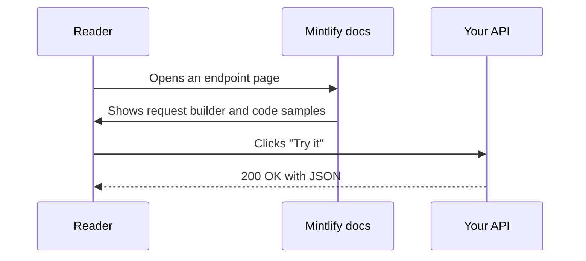
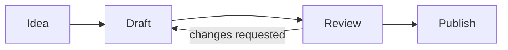

Every example below is real MDX. Open the page's **View as Markdown** option to copy any of it.

## Callouts

<Note>A **note** adds extra context.</Note>
<Tip>A **tip** shares a shortcut or best practice.</Tip>
<Info>An **info** callout highlights helpful background.</Info>
<Check>A **check** confirms success.</Check>
<Warning>A **warning** points out something to be careful about.</Warning>
<Danger>A **danger** callout flags something that can break things.</Danger>

## Cards

<CardGroup cols={3}>
  <Card title="Plain card" icon="star">
    A card with an icon and text.
  </Card>
  <Card title="Linked card" icon="link" href="/quickstart">
    Add `href` and the whole card is clickable.
  </Card>
  <Card title="Card with CTA" icon="arrow-right" href="/changelog" cta="See the changelog">
    Add `cta` for a custom link label.
  </Card>
</CardGroup>

<Card title="Horizontal card" icon="grip-lines" horizontal>
  Use `horizontal` for a compact, full-width layout.
</Card>

## Columns

<Columns cols={2}>
  <Card title="Left column" icon="arrow-left">Columns arrange anything in a responsive grid.</Card>
  <Card title="Right column" icon="arrow-right">They stack on small screens.</Card>
</Columns>

## Steps

<Steps>
  <Step title="First step" icon="1">
    Steps number a procedure automatically.
  </Step>
  <Step title="Second step">
    Put any content in a step, including code:

    ```bash
    echo "hello from a step"
    ```
  </Step>
  <Step title="Third step">
    Done.
  </Step>
</Steps>

## Tabs

<Tabs>
  <Tab title="First tab" icon="1">
    Tabs switch between alternatives, like operating systems or languages.
  </Tab>
  <Tab title="Second tab" icon="2">
    Readers' choice is remembered across pages that use the same tab titles.
  </Tab>
</Tabs>

## Code groups and code blocks

<CodeGroup>
  ```python Python
  def greet(name: str) -> str:
      return f"Hello, {name}!"
  ```

  ```javascript JavaScript
  const greet = (name) => `Hello, ${name}!`;
  ```

  ```go Go
  func greet(name string) string { return "Hello, " + name + "!" }
  ```
</CodeGroup>

```python title="highlight.py" lines highlight={2,3}
def total(items):
    subtotal = sum(items)       # highlighted
    return subtotal * 1.08      # highlighted
```

## Accordions

<AccordionGroup>
  <Accordion title="Closed by default" icon="chevron-down">
    Accordions hide detail until a reader wants it.
  </Accordion>
  <Accordion title="Open by default" defaultOpen>
    Set `defaultOpen` to start expanded.
  </Accordion>
</AccordionGroup>

## Diagrams with Mermaid

Write a fenced `mermaid` block and Mintlify renders it, in light and dark mode.





## API fields

<ParamField path="user_id" type="string" required>
  The ID of the user. Path parameters, query parameters, headers and body fields each have their own variant.
</ParamField>

<ParamField query="limit" type="integer" default="10">
  Maximum number of results.
</ParamField>

<ResponseField name="user" type="object" required>
  The user object.

  <Expandable title="properties">
    <ResponseField name="name" type="string">The user's name.</ResponseField>
    <ResponseField name="plan" type="string" default="free">The user's plan.</ResponseField>
  </Expandable>
</ResponseField>

## Request and response examples

<RequestExample>
  ```bash Request
  curl https://api.example.com/users/42
  ```
</RequestExample>

<ResponseExample>
  ```json Response
  { "user": { "name": "Ada", "plan": "free" } }
  ```
</ResponseExample>

## Frames and images

<Frame caption="An SVG image inside a Frame, with a caption.">
  
</Frame>

## Badges, tooltips and icons

<Badge color="green" icon="circle-check">Stable</Badge> <Badge color="orange" icon="clock">Beta</Badge> <Badge color="red" icon="ban">Deprecated</Badge> <Badge color="blue" stroke>Outlined</Badge> <Badge color="purple" shape="pill">Pill</Badge>

Hover over <Tooltip headline="OpenAPI" tip="A standard format for describing HTTP APIs. Mintlify turns it into an interactive API reference.">OpenAPI</Tooltip> to see a tooltip.

Icons inline: <Icon icon="rocket" size={16} /> <Icon icon="bolt" size={16} color="#0D9373" /> <Icon icon="heart" size={16} color="#EF4444" />

## Tree

<Tree>
  <Tree.Folder name="merge-sort-api" defaultOpen>
    <Tree.File name="main.py" />
    <Tree.File name="requirements.txt" />
    <Tree.Folder name="tests">
      <Tree.File name="test_main.py" />
    </Tree.Folder>
    <Tree.Folder name="docs" defaultOpen>
      <Tree.File name="docs.json" />
      <Tree.File name="index.mdx" />
      <Tree.File name="openapi.json" />
    </Tree.Folder>
  </Tree.Folder>
</Tree>

## Colors

<Color variant="compact">
  <Color.Item name="primary" value="#0D9373" />
  <Color.Item name="light" value="#55D799" />
  <Color.Item name="surface" value={{ light: "#F8FAFC", dark: "#0F172A" }} />
</Color>

## GitHub repo card

<GitHub.Repo repo="mintlify/docs" />

## Prompt

<Prompt description="Give this to your coding agent to write docs in your style.">
You are a technical writer. Write clear, concise documentation for developers.
- Use second person ("you") and active verbs.
- Start every procedure with a goal-oriented heading.
- Show a runnable code example for every endpoint.
</Prompt>

## Views

<View title="Python" icon="python">
  ```python
  print("Views switch the content for the whole page.")
  ```
</View>

<View title="JavaScript" icon="js">
  ```javascript
  console.log("Pick a language and the page changes.");
  ```
</View>

## Math

Inline math like $E = mc^2$ and block math:

$$
\sum_{i=1}^{n} i = \frac{n(n+1)}{2}
$$

## Tables and Markdown

| Feature | Free | Pro | Enterprise |
| --- | :---: | :---: | :---: |
| Docs hosting | Yes | Yes | Yes |
| AI assistant | | Yes | Yes |
| Multi-repo projects | | | Yes |

> Blockquotes, **bold**, *italic*, ~~strikethrough~~, `inline code` and [links](/quickstart) all work as you'd expect.

- [x] Task lists
- [ ] work too

<Panel>
  <Info>A **Panel** pins content to the right-hand side of the page. Use it for examples, summaries or links.</Info>
</Panel>
